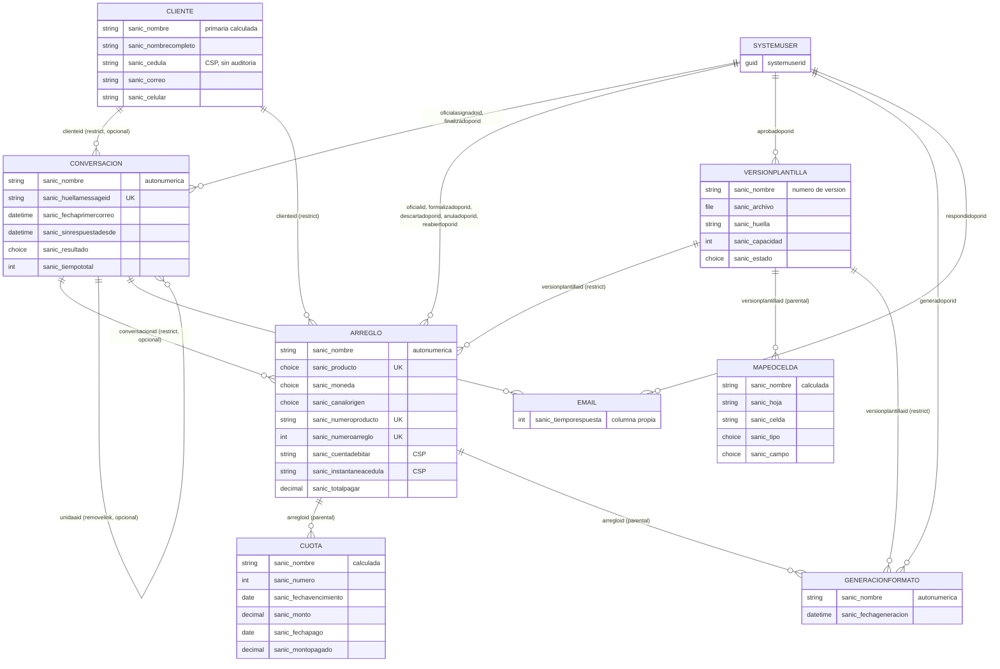

# 02. Diccionario de datos

Proyecto: 2026-003-control-arreglos-pago · Etapa 3 · Estado: **decidido por el usuario el 2026-10-09** (propuestas P-01 a P-21 aceptadas, con los cambios que fija la sección 11, más las decisiones de moneda, de cálculo del arreglo y de canal de origen). La pregunta P-22 (sección 11.6) quedó decidida el mismo día. Las reglas de negocio que la definición mantiene abiertas están en la sección 11.4 (el 2026-10-10 el usuario decidió R-03 y R-07; siguen abiertas R-06 y R-09).

Convenciones en `01-convenciones.md` (estándar BP-PP-181 a BP-PP-197). Fuente de verdad del diseño: `definicion.md` §5 y §6 (D-01 a D-36), ya validado con los spikes de `spikes/*/RESULTADO.md`. El mockup validado (versión 3, `mockup/index.html`) se usó para ver campos y estados; donde difiere de la definición, manda la definición y se anota en la sección 12.

## 0. Cómo leer este documento

**Tipos** (los de `power-platform-especificar/references/tabla.md`, más tres que esa referencia todavía no define y están señalados en la sección 11, H-01):

| Código | Significa |
|---|---|
| `texto T(n)` | Texto de una línea de n caracteres como máximo |
| `memo M(n)` | Texto multilínea de n caracteres como máximo |
| `entero [min..max]` | Número entero con rango |
| `decimal(p) [min..max]` | **Tipo sin cobertura en `tabla.md` (H-01).** Decimal con p decimales |
| `choice <nombre>` | Choice global (sección 3) |
| `sino` | Sí/No |
| `fechahora UL` | Fecha y hora, comportamiento **Usuario local** (BP-PP-191) |
| `fecha DO` | Solo fecha (`DateOnly`). **Irreversible.** Siempre con el motivo declarado |
| `archivo` | Columna de archivo |
| `formula` | **Tipo sin cobertura en `tabla.md` (H-01).** Columna de fórmula |

**Encabezados de las tablas de columnas.** *Req*: requerida por negocio (la aplica la app, no el servicio: por API una columna "requerida" puede llegar vacía). *Aud*: auditada a nivel de columna (D-20). *Seg*: protegida con seguridad por columna (D-19). *Sis*: solo-sistema (D-30): un plugin pre-update rechaza el cambio hecho por un usuario.

**Referencias a decisiones.** Las propuestas P-01 a P-21 se **aceptaron el 2026-10-09** (sección 11) y ya no llevan marca de propuesta en las secciones 3 a 8: lo que se lee ahí está decidido. Una cita `(P-nn)` en una celda remite a la decisión que explica el valor. P-22, que era la única abierta, se decidió el mismo día (sección 11.6) y no cambia el modelo. Un valor sin cita sale de la definición (se cita el requisito o la decisión) o de un hecho verificado en un spike.

**Nombres.** Los nombres lógicos van en minúscula, sin tildes y sin separadores dentro del segmento (BP-PP-184). Los nombres visibles van sin tildes ni eñe (BP-PP-197). Las etiquetas de metadatos se escriben en español en **los dos** idiomas (1033 y 3082), con el mismo texto, como fija `01-convenciones.md` §0. Las descripciones son prosa y llevan ortografía completa.

## 1. Decisiones de modelado derivadas de la definición

No son decisiones nuevas: son la lectura, columna por columna, de lo que la definición ya fijó.

| ID | Decisión | Origen |
|---|---|---|
| DD-01 | **Las siete tablas propias son de propiedad "Usuario o equipo"** (`OwnershipType = UserOwned`; el playbook de tabla lo escribe `propiedad: "usuario"`). La definición las llama "de propiedad de team": en Dataverse un team es un propietario válido de una tabla UserOwned. La propiedad es **irreversible**; una tabla de organización cerraría para siempre la posibilidad de que el team sea el dueño. El propietario real (team ARP) lo fija un plugin (D-31) | §6 Datos ("todas de propiedad de team"), D-04, D-31, BP-PP-013 |
| DD-02 | **Conversación y Arreglo modelan su estado con `statecode`/`statuscode`**, no con un choice propio. Los motivos de estado están en la sección 3.2. Los choices de la sección 3.1 no duplican esos estados | D-03, D-10, RF-15, RF-16 |
| DD-03 | **La versión de plantilla sí lleva un choice propio de estado** (Borrador, Vigente, Histórica), además de su `statecode` Activo/Inactivo, porque la definición lo describe como columna ("estado (Borrador, Vigente o Histórica)") y ~~la desactivación del catálogo es otra cosa (§6 "se desactivan, nunca se purgan")~~ el `statecode` no es el modo de retirar una versión: el catálogo se retira pasando a Histórica y nunca se purga (§6 Datos, D-40, 2026-10-11) | §6 Datos (Versión de plantilla) |
| DD-04 | **Fechas**: todo instante (llegada de un correo, finalización, congelamiento, formalización, anulación, generación, aprobación) es `fechahora UL` (BP-PP-191). Un día de calendario es `fecha DO`: vencimiento y pago de una cuota, inicio y fin del arreglo, fecha del formato. El spike 2 verificó que la vista de riesgo (D-11) funciona sobre cuotas con fecha `DO` | BP-PP-191, D-11, spike 2 (pregunta 5) |
| DD-05 | **Tiempos en minutos, enteros y persistidos** en Conversación y en Email. La antigüedad no se persiste: es una columna de fórmula en minutos dividida por 60 (`DateDiff` en horas cuenta cambios de hora de reloj; spike 2, pregunta 4) | RF-03, RF-04, D-27, spike 2 |
| DD-06 | **Columnas sensibles**: la cédula del Cliente, la cuenta a debitar y la cédula copiada en la instantánea llevan seguridad por columna y **no se auditan**; ninguna entra en una clave alterna (el spike 2 probó que la plataforma lo rechaza). El número de producto va en claro, sin seguridad por columna y sin auditoría, y sí entra en una clave | D-07, D-19, D-20, D-29, spike 2 (2a) |
| DD-07 | **Columna primaria**: nunca texto libre (BP-PP-192). La forma que usa cada tabla está en la sección 4 y su formato exacto está decidido (P-02). Ninguna primaria lleva el número de producto, la cédula ni la cuenta: la primaria hereda la auditoría de la tabla y aparece en todos los lookups | BP-PP-192, D-20 |
| DD-08 | **Un solo pago por cuota**: el pago es un par de columnas de la cuota, no una tabla. Confirmado por Héctor Romero, vía el usuario, el 2026-10-09 (R-01) | D-08, supuestos de §6 |
| DD-09 | **Tablas estándar, no elásticas**: las elásticas no admiten claves alternas ni cascada | §6 Datos (Volumen) |
| DD-10 | **Estado de los lookups**: un lookup "requerido" lo es porque la definición lo exige (cliente y versión de plantilla del arreglo, arreglo de la cuota y de la generación). El resto es opcional, en particular el cliente y el oficial de la conversación (remitentes desconocidos) y la conversación de origen del arreglo, porque un arreglo puede originarse por teléfono, presencial, en una sucursal o por correo (R-05, decidido el 2026-10-09); ese origen queda registrado en `sanic_canalorigen` (DD-13) | RF-01, RF-06, §6 Supuestos |
| DD-11 | **Moneda del arreglo**: una columna requerida `sanic_moneda` en Arreglo, con el choice global `sanic_carp_ch_moneda` (Cordobas, Dolares). Los montos siguen siendo `decimal(2)` (P-04) y se interpretan en la moneda del arreglo; las cuotas heredan la moneda de su arreglo y no llevan columna propia. No se usa el tipo Moneda de Dataverse: exige tipos de cambio y conversión a moneda base, que el área no necesita porque un arreglo nunca mezcla monedas | RF-06, RF-08, D-36, R-08 |
| DD-12 | **Saldo remanente y total a pagar los calcula el sistema**: `sanic_saldoremanente` (= saldo inicial − monto abonado) y `sanic_totalpagar` (= el menor entre cuota mensual × plazo y el saldo remanente) son requeridas y solo-sistema. Las escribe un plugin al crear el arreglo y al modificar el borrador, para que queden congeladas con el resto del acuerdo. No son columnas calculadas ni de fórmula de Dataverse. Reglas de montos (decisión del usuario, 2026-10-09): (1) si el monto abonado es mayor que el saldo inicial, el plugin rechaza el registro con un mensaje claro; (2) si cuota × plazo es mayor que el saldo remanente, la **última cuota se achica** a saldo remanente − cuota × (plazo − 1) y el total a pagar es el saldo remanente; (3) si cuota × plazo es menor o igual que el saldo remanente (alivio temporal), todas las cuotas son iguales y el total a pagar es cuota × plazo; (4) si con una cuota menos ya se cubre el saldo (la última cuota daría cero o negativa), el plugin rechaza con un mensaje que indica con cuántas cuotas se cubre. El generador del calendario crea la última cuota con su monto ajustado, y el formato imprime el monto de cada cuota tal como quedó | RF-06, RF-08, §6 Lógica (ítems 7 y 8), D-30, R-04 |
| DD-13 | **Canal de origen del arreglo**: una columna requerida `sanic_canalorigen` en Arreglo, con el choice global `sanic_carp_ch_canalorigen` (Correo, Telefono, Presencial, Sucursal). Cuando el arreglo se registra desde una conversación, el plugin pre-create completa "Correo" si la columna viene vacía. Es un dato de control del arreglo y por eso se audita. No es solo-sistema: la elige el oficial. Decisión de negocio del usuario del 2026-10-09 | RF-06, R-05 |

## 2. Diagrama del modelo

`SYSTEMUSER` y `EMAIL` son tablas estándar; las demás son las siete tablas propias. Las claves alternas se marcan `UK`, las columnas con seguridad por columna `CSP`. Validado con el validador de Mermaid.

## 3. Choices globales y motivos de estado

### 3.1 Choices globales (9)

Valor = `15946` × 10.000 + correlativo (BP-PP-193): `159460001`, `159460002`… Los correlativos son estables y no se reordenan; una opción que deja de usarse se retira de las vistas, no se borra. Etiqueta idéntica en 1033 y 3082 (español, sin tildes). Todos se construyen **antes** que las tablas que los usan.

#### `sanic_carp_ch_resultadoconversacion`

Display name: `CH - CARP - Resultado de conversacion` (1033 y 3082). Descripción: Resultado con el que el oficial finaliza una conversación. Lo usa la columna `sanic_resultado` de Conversación. Origen: RF-15, D-06.

| Valor | Etiqueta (1033 y 3082) | Descripción |
|---|---|---|
| 159460001 | Con arreglo de pago | La conversación terminó en un arreglo de pago. Hoy solo avisa si no hay un arreglo formalizado vinculado (R-06) |
| 159460002 | Sin arreglo de pago | La conversación se atendió y no terminó en arreglo |
| 159460003 | Sin respuesta | No hubo conversación real: exige motivo y detalle |

#### `sanic_carp_ch_motivosinrespuesta`

Display name: `CH - CARP - Motivo de sin respuesta`. Descripción: Motivo obligatorio cuando una conversación se finaliza con el resultado "Sin respuesta". Lo usa `sanic_motivosinrespuesta` de Conversación. Origen: RF-15, D-06.

| Valor | Etiqueta (1033 y 3082) | Descripción |
|---|---|---|
| 159460001 | Spam | Correo no deseado |
| 159460002 | Respuesta automatica | Respuesta automática de otro sistema |
| 159460003 | El cliente no volvio a escribir | El cliente dejó de responder |
| 159460004 | Otro | Cualquier otro motivo, que se explica en el detalle |

#### `sanic_carp_ch_productocrediticio`

Display name: `CH - CARP - Producto crediticio`. Descripción: Producto sobre el que se hace el arreglo: préstamo o tarjeta. Lo usa `sanic_producto` de Arreglo, que es parte de la clave alterna del número de arreglo. Origen: RF-06, RF-17.

| Valor | Etiqueta (1033 y 3082) | Descripción |
|---|---|---|
| 159460001 | Prestamo | Préstamo |
| 159460002 | Tarjeta | Tarjeta de crédito |

#### `sanic_carp_ch_tipoarreglo`

Display name: `CH - CARP - Tipo de arreglo`. Descripción: Tipo de arreglo según el formato F-NIC-0000052. Lo usa `sanic_tipo` de Arreglo. Origen: RF-06.

| Valor | Etiqueta (1033 y 3082) | Descripción |
|---|---|---|
| 159460001 | Temporal | Arreglo temporal |
| 159460002 | Cancelacion | Arreglo de cancelación del saldo |

#### `sanic_carp_ch_moneda`

Display name: `CH - CARP - Moneda`. Descripción: Moneda en la que se expresan los montos de un arreglo y de sus cuotas: córdobas o dólares. Lo usa `sanic_moneda` de Arreglo. Un arreglo nunca mezcla monedas. Origen: RF-06, RF-08, D-36, R-08.

| Valor | Etiqueta (1033 y 3082) | Descripción |
|---|---|---|
| 159460001 | Cordobas | Córdobas nicaragüenses |
| 159460002 | Dolares | Dólares estadounidenses |

#### `sanic_carp_ch_canalorigen`

Display name: `CH - CARP - Canal de origen`. Descripción: Canal por el que llegó el pedido que originó el arreglo. Lo usa `sanic_canalorigen` de Arreglo. Origen: RF-06, DD-13 (decisión de negocio del 2026-10-09).

| Valor | Etiqueta (1033 y 3082) | Descripción |
|---|---|---|
| 159460001 | Correo | El cliente lo pidió por correo al buzón del área |
| 159460002 | Telefono | El cliente lo pidió por teléfono |
| 159460003 | Presencial | El cliente lo pidió en persona en el área de Arreglos de Pago |
| 159460004 | Sucursal | El cliente lo pidió en una sucursal bancaria |

#### `sanic_carp_ch_estadoversionplantilla`

Display name: `CH - CARP - Estado de version de plantilla`. Descripción: Estado de una versión de la plantilla del formato. Hay una sola versión Vigente a la vez. Lo usa `sanic_estado` de Versión de plantilla. Origen: §6 Datos (Versión de plantilla), D-14, D-15.

| Valor | Etiqueta (1033 y 3082) | Descripción |
|---|---|---|
| 159460001 | Borrador | Se edita libremente; admite vista previa del jefe |
| 159460002 | Vigente | La que toman los arreglos nuevos; inmutable |
| 159460003 | Historica | Reemplazada por otra Vigente; inmutable |

#### `sanic_carp_ch_tipomapeo`

Display name: `CH - CARP - Tipo de mapeo`. Descripción: Tipo de una fila del mapeo celda → campo. Lo usa `sanic_tipo` de Mapeo de celda. Origen: §6 Datos (Mapeo de celda), D-16.

| Valor | Etiqueta (1033 y 3082) | Descripción |
|---|---|---|
| 159460001 | Valor simple | Reemplaza el contenido de la celda, incluida una fórmula |
| 159460002 | Total calculado | Total que calcula el generador desde los datos |
| 159460003 | Columna de bloque de cuotas | Columna del bloque repetido de cuotas; la celda es la de la primera cuota |

#### `sanic_carp_ch_campomapeable`

Display name: `CH - CARP - Campo mapeable`. Descripción: Campos que el generador del formato sabe escribir en una celda. La lista está acoplada al código del generador y la mantiene el equipo de la solución, no el negocio. Lo usa `sanic_campo` de Mapeo de celda. Origen: D-14, §6 Datos (Mapeo de celda). **La lista de 27 opciones no está enumerada en la definición**: las primeras 26 salen de las constantes del generador del spike 1 (`spikes/plantilla/src/ArreglosPago.Formato/Campos.cs` y el mapeo de `tools/Medicion/Program.cs`) y de la constante `FIELDS` del mockup v3, que coinciden; la 27 (Moneda) se agrega por la decisión de moneda (D-36), para que el formato pueda imprimirla. La lista fue aceptada por el usuario el 2026-10-09 (P-18). El generador del spike 1 todavía no tiene la clave `moneda`: hay que agregarla al código y al `enum`.

| Valor | Etiqueta (1033 y 3082) | Clave del generador | Tipo de mapeo que admite |
|---|---|---|---|
| 159460001 | Fecha de formalizacion | `fechaFormalizacion` | Valor simple |
| 159460002 | Oficial de arreglo | `oficial` | Valor simple |
| 159460003 | Nombre del cliente | `clienteNombre` | Valor simple |
| 159460004 | Cedula del cliente | `clienteCedula` | Valor simple |
| 159460005 | Correo del cliente | `clienteCorreo` | Valor simple |
| 159460006 | Celular del cliente | `clienteCelular` | Valor simple |
| 159460007 | Numero de prestamo o tarjeta | `numeroProducto` | Valor simple |
| 159460008 | Tipo de arreglo | `tipo` | Valor simple |
| 159460009 | Numero de arreglo | `numeroArreglo` | Valor simple |
| 159460010 | Saldo inicial | `saldoInicial` | Valor simple |
| 159460011 | Monto abonado | `montoAbonado` | Valor simple |
| 159460012 | Saldo remanente | `saldoRemanente` | Valor simple |
| 159460013 | Plazo en cuotas | `plazo` | Valor simple |
| 159460014 | Cuota mensual | `cuota` | Valor simple |
| 159460015 | Total a pagar | `totalPagar` | Valor simple |
| 159460016 | Fecha de inicio | `fechaInicio` | Valor simple |
| 159460017 | Fecha de finalizacion | `fechaFin` | Valor simple |
| 159460018 | Cuenta a debitar | `cuentaDebitar` | Valor simple |
| 159460019 | Comentarios | `comentarios` | Valor simple |
| 159460020 | Cuota: numero | `cuota.numero` | Columna de bloque de cuotas |
| 159460021 | Cuota: fecha de vencimiento | `cuota.fecha` | Columna de bloque de cuotas |
| 159460022 | Cuota: monto | `cuota.monto` | Columna de bloque de cuotas |
| 159460023 | Cuota: fecha de pago | `cuota.fechaPago` | Columna de bloque de cuotas |
| 159460024 | Cuota: monto pagado | `cuota.montoPagado` | Columna de bloque de cuotas |
| 159460025 | Total: montos de cuota | `total.montoCuotas` | Total calculado |
| 159460026 | Total: montos pagados | `total.montoPagado` | Total calculado |
| 159460027 | Moneda | `moneda` | Valor simple |

La clave del generador es lo que el código C# traduce de la opción; el código nunca usa el literal numérico (BP-PP-193): usa un `enum` generado desde esta tabla. La columna "tipo de mapeo que admite" no es dato de Dataverse: es la regla que valida el plugin de publicación (D-15, ítem 15).

### 3.2 Motivos de estado de las tablas (`statecode` / `statuscode`)

No son choices globales. Se declaran en el playbook de la tabla correspondiente. Verificado en Microsoft Learn (*Table definitions in Microsoft Dataverse*): en una tabla propia, `statecode` tiene dos valores fijos (0 Activo, 1 Inactivo, **no se pueden agregar**) y `statuscode` parte de dos motivos por defecto (1 asociado a Activo, 2 asociado a Inactivo) a los que se pueden agregar más para cada estado. Por eso, de los motivos por defecto se **renombra** uno por estado y los demás se agregan con valores `15946`+correlativo (P-13).

**Conversación** (D-03, RF-15)

| `statecode` | `statuscode` | Etiqueta (1033 y 3082) | Origen del valor | Cómo se llega |
|---|---|---|---|---|
| 0 Activo | 1 | Abierta | Motivo por defecto 1 renombrado. Es el estado inicial | Alta (plugin de entrada de correo, como sistema); "Reabrir" |
| 1 Inactivo | 2 | Finalizada | Motivo por defecto 2 renombrado | Gesto Finalizar, con resultado |
| 1 Inactivo | 159460001 | Unida | Agregado | Solo la Custom API "Unir conversaciones" |

Una conversación Finalizada o Unida no se modifica sin reabrir: el plugin rechaza cualquier cambio de una persona (`CARP-CNV-009`), salvo el gesto Reabrir de una Finalizada (D-39, 2026-10-11). Reabrir no admite otro cambio en el mismo guardado (cliente, nombre, oficial asignado o propietario; `CARP-CNV-010`, D-40, 2026-10-11).

**Arreglo** (D-10, RF-16)

| `statecode` | `statuscode` | Etiqueta (1033 y 3082) | Origen del valor | Cómo se llega |
|---|---|---|---|---|
| 0 Activo | 1 | Borrador | Motivo por defecto 1 renombrado. Es el estado inicial | Alta; "Desbloquear" no cambia de estado |
| 0 Activo | 159460001 | Vigente | Agregado | Gesto Formalizar (solo desde Borrador congelado); "Reabrir" desde Terminado o Vigente congelado |
| 1 Inactivo | 2 | Terminado | Motivo por defecto 2 renombrado | Automático: todas las cuotas con pago registrado |
| 1 Inactivo | 159460002 | Anulado | Agregado | Gesto Anular (solo desde Vigente), con motivo |
| 1 Inactivo | 159460003 | Descartado | Agregado | Gesto Descartar (solo desde Borrador), con motivo |

Anulado y Descartado no se reabren (D-10, ítem 10). Las transiciones las impone el plugin (D-30), no la transición de motivos de la plataforma. Los dos gestos Reabrir (de un Terminado y de un Vigente congelado) no admiten otro cambio en el mismo guardado (`CARP-ARR-012`; D-40, 2026-10-11).

## 4. Tablas

Cada tabla trae sus datos de playbook (`power-platform-especificar/references/tabla.md`), sus columnas propias que no son lookup, sus lookups (que nacen con la relación de la sección 6) y sus notas. El `nombre lógico` de la tabla y el de cada columna son irreversibles.

### 4.1 `sanic_carp_tbl_cliente`

| Dato | Valor |
|---|---|
| Display name singular / plural | `Cliente` / `Clientes` |
| Descripción | Persona que solicita o tiene un arreglo de pago. Tabla propia de la solución, sin usar la tabla estándar de contactos. |
| Propiedad | usuario o equipo (DD-01) |
| Notas / Actividades | no / no (la definición no las pide; se pueden activar después, desactivar no) |
| Auditoría de tabla | **No** (D-20: para no copiar la cédula y el contacto a los logs). Sus cambios solo quedan en las columnas de sistema de modificación |
| Columna primaria | `sanic_nombre`, display `Nombre`, forma **calculada** por plugin; requerida |
| Origen | RF-05, D-07, D-20 |

| Nombre lógico | Display name | Tipo y forma | Req | Aud | Seg | Sis | Descripción | Origen |
|---|---|---|---|---|---|---|---|---|
| `sanic_nombre` | Nombre | texto T(200); primaria calculada: copia del nombre completo normalizado (sin espacios dobles) | Sí | No | No | No | Nombre con el que se muestra el cliente en listas y lookups. Lo calcula el sistema a partir del nombre completo; nadie lo digita. | BP-PP-192 |
| `sanic_nombrecompleto` | Nombre completo | texto T(200) | Sí | No | No | No | Nombre completo del cliente tal como lo digita el oficial. | RF-05 |
| `sanic_cedula` | Cedula | texto T(20); normalizada por plugin | Sí | **No** | **Sí** | No | Número de cédula del cliente. Dato sensible protegido con seguridad por columna; su unicidad la valida un plugin al crear, porque una columna protegida no puede ser parte de una clave alterna. | RF-05, D-07, D-19, D-20 |
| `sanic_correo` | Correo | texto T(320), formato Email; en minúscula y sin espacios | No | No | No | No | Correo electrónico del cliente. Si coincide con el remitente de un correo entrante, el plugin vincula la conversación al cliente. | RF-05, §6 Datos (Cliente) |
| `sanic_celular` | Celular | texto T(20), formato Texto | No | No | No | No | Número de celular del cliente. | RF-05 |

Lookups: ninguno. Estado: el `statecode`/`statuscode` nativos del cliente solo los cambia SYSTEM; una persona no activa ni desactiva un cliente (`CARP-CLI-004`; D-40, decisión del usuario del 2026-10-11). La purga elimina clientes con `Delete` y no se ve afectada. Quick find de Cliente: cédula, nombre, correo y celular (D-12; se configura en la vista de búsqueda rápida, no en el playbook de tabla). El plugin pre-create fija el team ARP como propietario (D-31).

### 4.2 `sanic_carp_tbl_conversacion`

| Dato | Valor |
|---|---|
| Display name singular / plural | `Conversacion` / `Conversaciones` |
| Descripción | Hilo de correos de ida y vuelta entre el área y un cliente. Agrupa los correos entrantes y las respuestas mediante la columna Regarding del Email; se finaliza a mano con un resultado. |
| Propiedad | usuario o equipo (DD-01) |
| Notas | no |
| **Actividades** | **sí**: necesaria para que la Conversación sea el Regarding del Email (D-03, ítem 1). **Irreversible** (no se puede desactivar). Al activarla la plataforma crea la relación Email → Conversación (sección 6.3) |
| Auditoría de tabla | **Sí** (D-20). Columnas auditadas: las marcadas en *Aud* |
| Concurrencia optimista | Debe quedar activa (`IsOptimisticConcurrencyEnabled = true`): "Tomar" depende de ella (D-04; en el spike 2 estaba activa por defecto en una tabla propia). El playbook la comprueba |
| Columna primaria | `sanic_nombre`, display `Numero`, forma **autonumérica**, formato `CONV-{SEQNUM:6}` (P-02); opcional (se llena sola) |
| Origen | RF-01, RF-02, RF-03, RF-04, RF-14, RF-15, D-03, D-04, D-05, D-06, D-27, D-30, D-32, P-10 |

| Nombre lógico | Display name | Tipo y forma | Req | Aud | Seg | Sis | Descripción | Origen |
|---|---|---|---|---|---|---|---|---|
| `sanic_nombre` | Numero | primaria autonumérica `CONV-{SEQNUM:6}` (P-02) | No | Sí (hereda) | No | **Sí** (desde el 2026-10-11, D-41; ~~No~~) | Número correlativo de la conversación, que el área cita al hablar de ella. Lo asigna el sistema al crear. **La plataforma lo completa antes de los plugins y guarda tal cual el valor que envíe la persona (V-8 en el Arreglo; por verificar en Conversación, H-14)**, así que el plugin de alta rechaza un valor que no cumpla `^CONV-[0-9]{6,15}$` (15 y no 16 dígitos porque la columna mide 20; `CARP-CNV-001`); un `CONV-nnnnnn` falsificado por API pasa (riesgo aceptado). En el Update una persona no lo cambia en ningún estado (`CARP-CNV-001`; en una Finalizada o Unida, `CARP-CNV-009`). Las altas del sistema (entrada de correo, iniciar conversación nueva) no se ven afectadas. | BP-PP-192, D-41 |
| `sanic_huellamessageid` | Huella del Message-ID | texto T(64) (SHA-256 en hexadecimal, minúscula) | Sí | No | No | **Sí** | Huella SHA-256 del Message-ID normalizado del primer correo. Es la clave alterna que garantiza que un correo reprocesado no cree dos conversaciones; la huella evita que un Message-ID largo supere el límite de tamaño de la clave. | D-03, D-30, ítem 1 |
| `sanic_fechaprimercorreo` | Fecha del primer correo | fechahora UL | Sí | No | No | **Sí** | Fecha y hora de llegada del primer correo, tomada de `actualend` del Email (coincide con la recepción en Exchange; spike 3) y no de `createdon`, para no sumar la demora de la sincronización. Inicio del tiempo total. | RF-03, D-03, D-30, spike 3 |
| `sanic_asunto` | Asunto | texto T(400) | No | No | No | **Sí** | Asunto del primer correo de la conversación, copiado por el sistema al crearla. Permite que la vista de conversaciones muestre de qué se trata sin abrir el timeline. | RF-04, P-10 |
| `sanic_remitente` | Remitente | texto T(320) | No | No | No | **Sí** | Dirección del remitente del primer correo, copiada por el sistema al crear la conversación. Permite ver de quién es cuando el cliente está vacío (remitente desconocido), antes de que el oficial lo vincule o lo cree. | RF-01, RF-04, P-10 |
| `sanic_sinrespuestadesde` | Sin respuesta desde | fechahora UL | No | No | No | **Sí** | Fecha del primer correo del cliente que todavía no tiene respuesta; vacía si no falta responder nada. Las vistas de pendientes y la antigüedad salen de ella. Debe ser `UL`: la fórmula de antigüedad usa `Now()` (spike 2). | RF-04, D-03, D-27, D-30 |
| `sanic_correonuevoenfinalizada` | Correo nuevo en finalizada | sino; etiquetas Si / No; defecto No | Sí | No | No | **Sí** | Lo marca el sistema cuando llega un correo a una conversación finalizada; el correo cuenta como sin respuesta hasta que el oficial decide reabrir o iniciar una conversación nueva. | RF-15, D-30, D-32 |
| `sanic_resultado` | Resultado | choice `sanic_carp_ch_resultadoconversacion` | No (obligatoria al finalizar, la valida el plugin) | **Sí** | No | No | Resultado con el que se finalizó la conversación. Se limpia al reabrir. | RF-15, D-06 |
| `sanic_motivosinrespuesta` | Motivo de sin respuesta | choice `sanic_carp_ch_motivosinrespuesta` | No (obligatoria si el resultado es Sin respuesta) | **Sí** | No | No | Motivo de la finalización cuando el resultado es Sin respuesta. | RF-15, D-06 |
| `sanic_detallesinrespuesta` | Detalle de sin respuesta | memo M(1000) | No (obligatoria si el resultado es Sin respuesta) | **Sí** | No | No | Explicación del motivo de la finalización cuando el resultado es Sin respuesta. | RF-15, D-06 |
| `sanic_fechafinalizacion` | Fecha de finalizacion | fechahora UL | No | **Sí** | No | **Sí** | Fecha y hora en que la conversación dejó de estar Abierta, por finalización o por unión. Alimenta la retención de 2 años. | RF-15, D-22, D-30 |
| `sanic_tiempoprimerarespuesta` | Tiempo de primera respuesta (minutos) | entero [0..2147483647] | No | No | No | **Sí** | Minutos desde el primer correo del cliente que esperaba respuesta hasta la primera respuesta enviada. Persistido. | RF-03, DD-05, D-30 |
| `sanic_tiempototal` | Tiempo total (minutos) | entero [0..2147483647] | No | No | No | **Sí** | Minutos desde el primer correo hasta la finalización. Persistido; se recalcula en la próxima finalización si la conversación se reabre. | RF-03, D-06, D-30 |
| `sanic_cantidadrespuestas` | Cantidad de respuestas | entero [0..2147483647]; defecto 0 | Sí | No | No | **Sí** | Respuestas enviadas desde la solución en esta conversación. | RF-03, D-05, D-30 |
| `sanic_antiguedad` | Antiguedad (horas) | **formula** decimal(2): `DateDiff(sanic_sinrespuestadesde, Now(), TimeUnit.Minutes) / 60` | No | No | No | No (calculada) | Horas desde que el último correo del cliente espera respuesta, calculada al leer. | RF-04, D-27, spike 2 (pregunta 4) |

Notas de la columna de fórmula: se crea desde el editor de Power Apps, porque Microsoft no soporta definir fórmulas por código (spike 2); no se puede ordenar por una fórmula que use `UTCNow()`, y esta usa `Now()`, que exige la columna base en `UL`; no se audita; no se puede proteger. Es un tipo de componente que la skill no cubre (H-01) y que se construye a mano (P-20).

Lookups (nacen con su relación, sección 6):

| Nombre lógico | Display name | Destino | Req | Aud | Relación | Origen |
|---|---|---|---|---|---|---|
| `sanic_clienteid` | Cliente | `sanic_carp_tbl_cliente` | No | No | REL-01 | RF-01, §6 Datos (Cliente: remitentes desconocidos quedan con el cliente vacío) |
| `sanic_oficialasignadoid` | Oficial asignado | `systemuser` | No | **Sí** | REL-10 | RF-02, D-04 |
| `sanic_finalizadoporid` | Finalizado por | `systemuser` | No | **Sí** | REL-11 | RF-15, D-30. Lo escribe el sistema con el `InitiatingUserId` |
| `sanic_unidaaid` | Unida a | `sanic_carp_tbl_conversacion` (la misma tabla) | No | **Sí** | REL-09 | RF-14, D-30 |

Estado: `statecode`/`statuscode` según la sección 3.2; ambos auditados. El estado lo cambia el usuario solo con los gestos Finalizar y Reabrir; Unida lo fija solo la Custom API de unir (D-30). Quick find/vistas: no definidas por la definición (fuera del diccionario).

### 4.3 `sanic_carp_tbl_arreglo`

| Dato | Valor |
|---|---|
| Display name singular / plural | `Arreglo` / `Arreglos` |
| Descripción | Arreglo de pago de un préstamo o una tarjeta, con los datos del formato F-NIC-0000052. Nace en borrador, se puede descartar y pasa a vigente al formalizarlo. |
| Propiedad | usuario o equipo (DD-01) |
| Notas / Actividades | no / no |
| Auditoría de tabla | **Sí** (D-20). Solo las columnas marcadas en *Aud*: control de estado, fechas de control, formalización, descarte, anulación, reapertura y versión de plantilla. **No** se auditan el número de producto, la cuenta a debitar ni la cédula copiada |
| Columna primaria | `sanic_nombre`, display `Codigo interno`, forma **autonumérica**, formato `ARR-{SEQNUM:6}`; opcional. **No** lleva el número de producto (DD-07). No se confunde con el número de arreglo (consecutivo por crédito, `sanic_numeroarreglo`) |
| Origen | RF-06, RF-07, RF-08, RF-10, RF-11, RF-12, RF-13, RF-16, RF-17, D-08, D-09, D-10, D-19, D-20, D-25, D-29, D-30, D-33, D-36 |

Los valores de *Req* tomados del mockup v3 (el mockup valida como obligatorio cada dato del formato al guardar) se fijaron en P-05 (aceptada el 2026-10-09): la definición dice que el arreglo registra "todos los datos del formato" pero no fija requerida columna por columna.

| Nombre lógico | Display name | Tipo y forma | Req | Aud | Seg | Sis | Descripción | Origen |
|---|---|---|---|---|---|---|---|---|
| `sanic_nombre` | Codigo interno | primaria autonumérica `ARR-{SEQNUM:6}` | No | Sí (hereda) | No | **Sí** (desde el 2026-10-11, D-39; ~~No~~) | Código interno correlativo del arreglo, asignado por el sistema al crear, también en borrador. No es el número de arreglo del crédito. Una persona no lo cambia en ningún estado. **En el Create la plataforma lo completa antes de PreValidation y guarda tal cual el valor que envíe la persona (V-8, 2026-10-11)**, así que el plugin de alta rechaza un valor que no cumpla `^ARR-[0-9]{6,16}$` (`CARP-ARR-009`; D-40); un `ARR-nnnnnn` falsificado por API pasa (riesgo aceptado). | BP-PP-192, DD-07 |
| `sanic_producto` | Producto crediticio | choice `sanic_carp_ch_productocrediticio` | Sí | No | No | No | Producto sobre el que se hace el arreglo: préstamo o tarjeta. No se cambia una vez que el borrador se congela. | RF-06, RF-17, D-33 |
| `sanic_numeroproducto` | Numero de prestamo o tarjeta | texto T(30); sin espacios y en mayúscula | Sí | **No** | **No** | No | Número del préstamo o de la tarjeta, en claro. Forma parte de la clave alterna del número de arreglo y se busca con quick find. Su tratamiento queda pendiente de Cumplimiento (R-09). | RF-06, RF-07, RF-13, D-20, D-29 |
| `sanic_numeroarreglo` | Numero de arreglo | entero [1..9999] | No (vacío en borrador) | Sí | No | **Sí** | Consecutivo por crédito (cuántas veces ese préstamo o tarjeta tuvo arreglo). Vacío en borrador; lo fija el sistema al formalizar. Parte de la clave alterna. | RF-07, D-09, D-30, D-33 |
| `sanic_numeroprovisional` | Numero provisional impreso | entero [1..9999] | No | No | No | **Sí** | Número que salió impreso en el formato para firma (`max+1` de los arreglos formalizados del crédito). El sistema lo compara al formalizar. Se vacía al desbloquear o reabrir. | RF-16, D-09, D-30 |
| `sanic_tipo` | Tipo de arreglo | choice `sanic_carp_ch_tipoarreglo` | Sí | No | No | No | Tipo de arreglo: temporal o cancelación. | RF-06 |
| `sanic_moneda` | Moneda | choice `sanic_carp_ch_moneda` | Sí | No | No | No | Moneda del arreglo: córdobas o dólares. Todos los montos del arreglo y de sus cuotas se interpretan en esta moneda; las cuotas la heredan y no llevan columna propia. Como dato del acuerdo, la bloquea el congelamiento (D-25). | RF-06, RF-08, D-25, D-36, R-08 |
| `sanic_canalorigen` | Canal de origen | choice `sanic_carp_ch_canalorigen` | Sí | **Sí** | No | No | Canal por el que llegó el pedido. Si el arreglo se registra desde una conversación y viene vacío, el plugin pre-create completa "Correo". Dato del acuerdo: lo bloquea el congelamiento (D-25). | RF-06, DD-13 |
| `sanic_saldoinicial` | Saldo inicial | decimal(2) [0..999999999.99] | Sí | No | No | No | Saldo inicial del crédito al momento del arreglo, en la moneda del arreglo. | RF-06 |
| `sanic_montoabonado` | Monto abonado | decimal(2) [0..999999999.99] | Sí | No | No | No | Monto abonado a la fecha, en la moneda del arreglo. | RF-06 |
| `sanic_saldoremanente` | Saldo remanente | decimal(2) [0..999999999.99] (P-04) | Sí | No | No | **Sí** | Saldo remanente por pagar = saldo inicial − monto abonado, en la moneda del arreglo. Lo calcula el plugin al crear el arreglo y al modificar el borrador, y queda congelado con el resto del acuerdo; nadie lo digita. No es una columna calculada ni de fórmula de Dataverse: el plugin escribe el valor. | RF-06, R-04, D-30 |
| `sanic_plazo` | Plazo en cuotas | entero [1..60] | Sí | No | No | No | Cantidad de cuotas del arreglo, hasta 60 y sin superar la capacidad de la versión de plantilla. | RF-06, RF-08, ítem 7 |
| `sanic_cuotamensual` | Cuota mensual | decimal(2) [0..999999999.99] | Sí | No | No | No | Monto de la cuota mensual, en la moneda del arreglo. | RF-06 |
| `sanic_totalpagar` | Total a pagar | decimal(2) [0..999999999.99] (P-04) | Sí | No | No | **Sí** | Total a pagar del arreglo = el menor entre cuota mensual × plazo y el saldo remanente, en la moneda del arreglo (si cuota × plazo supera el saldo remanente, la última cuota se achica y el total es el saldo remanente). Lo calcula el plugin al crear el arreglo y al modificar el borrador, y queda congelado con el resto del acuerdo; nadie lo digita. No es una columna calculada ni de fórmula de Dataverse: el plugin escribe el valor. | RF-06, R-04, D-30 |
| `sanic_fechainicio` | Fecha de inicio | **fecha DO** | Sí | No | No | No | Fecha de la primera cuota. Solo fecha porque representa un día de calendario, no un instante. | RF-06, DD-04 |
| `sanic_fechafin` | Fecha de finalizacion | **fecha DO** | Sí | No | No | No | Fecha de la última cuota (el mockup la calcula con el plazo). Solo fecha por la misma razón. La regla de fechas de vencimiento está decidida (R-03): el plugin la calcula y la sobrescribe con el vencimiento de la última cuota. | RF-06, DD-04, R-03 |
| `sanic_cuentadebitar` | Cuenta a debitar | texto T(20) | Sí | **No** | **Sí** | No | Cuenta desde la que se debitan las cuotas. Dato sensible protegido con seguridad por columna y sin auditoría. | RF-06, D-19, D-20 |
| `sanic_fechaformalizacion` | Fecha de formalizacion | **fecha DO** | Sí | No | No | No | Fecha de formalización que se imprime en el formato. Es un valor almacenado, no calculado (la plantilla v07 ya no trae `=TODAY()`): no cambia al reabrir el documento. No es la fecha del gesto Formalizar (P-07). | RF-06, D-16 |
| `sanic_comentarios` | Comentarios | memo M(500) | No | No | No | No | Comentarios del oficial, que se imprimen en el formato. El largo que cabe en la celda de la plantilla está abierto (P-21). | RF-06 |
| `sanic_fechacongelamiento` | Fecha de congelamiento | fechahora UL | No | **Sí** | No | **Sí** | Fecha de la generación del formato para firma. Desde ahí los datos del acuerdo, las cuotas y la versión de plantilla quedan bloqueados. Se vacía al desbloquear o reabrir. | RF-16, D-25, D-30 |
| `sanic_instantaneanombre` | Cliente al congelar: nombre | texto T(200) | No | No | No | **Sí** | Nombre del cliente copiado al congelar, tal como se imprimió. Los cambios posteriores en el Cliente no alteran el documento. Se vacía al reabrir. | D-25, D-30, ítem 10 |
| `sanic_instantaneacedula` | Cliente al congelar: cedula | texto T(20) | No | **No** | **Sí** | **Sí** | Cédula copiada al congelar. Mismo tratamiento que la del Cliente: seguridad por columna, sin auditoría, sin quick find ni vistas. Se purga con el arreglo. | D-19, D-20, D-25, D-30 |
| `sanic_instantaneacorreo` | Cliente al congelar: correo | texto T(320) | No | No | No | **Sí** | Correo del cliente copiado al congelar, tal como se imprimió. | D-25, D-30 |
| `sanic_instantaneacelular` | Cliente al congelar: celular | texto T(20) | No | No | No | **Sí** | Celular del cliente copiado al congelar, tal como se imprimió. | D-25, D-30 |
| `sanic_fechaformalizado` | Formalizado el | fechahora UL | No | **Sí** | No | **Sí** | Fecha y hora en que el oficial usó el gesto Formalizar (registro del gesto, distinto de la fecha impresa en el formato). | RF-16, D-30, ítem 9 |
| `sanic_motivodescarte` | Motivo de descarte | memo M(500) | No (obligatorio al descartar, lo valida el plugin) | **Sí** | No | No | Por qué un borrador no se concretó. | RF-16, D-10 |
| `sanic_fechadescarte` | Fecha de descarte | fechahora UL | No | **Sí** | No | **Sí** | Fecha y hora del gesto Descartar. | RF-16, D-30 |
| `sanic_motivoanulacion` | Motivo de anulacion | memo M(500) | No (obligatorio al anular, lo valida el plugin) | **Sí** | No | No | Por qué se anuló un arreglo vigente. | RF-12 |
| `sanic_fechaanulacion` | Fecha de anulacion | fechahora UL | No | **Sí** | No | **Sí** | Fecha y hora del gesto Anular. | RF-12, D-30 |
| `sanic_motivoreapertura` | Motivo de reapertura | memo M(500) | No (obligatorio al reabrir, lo valida el plugin) | **Sí** | No | No | Por qué la jefatura reabrió un arreglo congelado o terminado (dato congelado a corregir, pago erróneo). | RF-10, RF-12, D-25 |
| `sanic_fechareapertura` | Fecha de reapertura | fechahora UL | No | **Sí** | No | **Sí** | Fecha y hora de la última reapertura. | RF-12, D-30 |
| `sanic_cantidadreaperturas` | Cantidad de reaperturas | entero [0..999]; defecto 0 | Sí | **Sí** | No | **Sí** | Contador de reaperturas del arreglo. | RF-12, D-30 |
| `sanic_fechatermino` | Fecha de termino | fechahora UL | No | **Sí** | No | **Sí** | Fecha y hora en que el arreglo terminó, se anuló o se descartó. Alimenta la retención de 2 años (BulkDelete). Un borrador sin resolver no la tiene. | RNF-07, D-22, D-30 |

Lookups (nacen con su relación, sección 6):

| Nombre lógico | Display name | Destino | Req | Aud | Sis | Relación | Origen |
|---|---|---|---|---|---|---|---|
| `sanic_clienteid` | Cliente | `sanic_carp_tbl_cliente` | **Sí** | No | No | REL-02 | RF-06 (vinculado al cliente) |
| `sanic_conversacionid` | Conversacion de origen | `sanic_carp_tbl_conversacion` | No | No | No | REL-03 | RF-06; opcional, confirmado el 2026-10-09 (R-05): un arreglo puede originarse por teléfono, presencial, en una sucursal o por correo |
| `sanic_versionplantillaid` | Version de plantilla | `sanic_carp_tbl_versionplantilla` | **Sí** | **Sí** | **Sí** | REL-04 | RF-08, D-15, D-30. La fija el plugin pre-create; se rechaza el alta si no hay versión Vigente |
| `sanic_oficialid` | Oficial de arreglo | `systemuser` | **Sí** | No | No | REL-12 | RF-06 |
| `sanic_formalizadoporid` | Formalizado por | `systemuser` | No | **Sí** | **Sí** | REL-13 | RF-16, D-30 |
| `sanic_descartadoporid` | Descartado por | `systemuser` | No | **Sí** | **Sí** | REL-14 | RF-16, D-30 |
| `sanic_anuladoporid` | Anulado por | `systemuser` | No | **Sí** | **Sí** | REL-15 | RF-12, D-30 |
| `sanic_reabiertoporid` | Reabierto por | `systemuser` | No | **Sí** | **Sí** | REL-16 | RF-12, D-30 |

Estado: `statecode`/`statuscode` según la sección 3.2, ambos auditados. Los pasos a Vigente, Descartado, Anulado y la reapertura se aceptan solo con su gesto (D-30). Quick find: número de producto (D-12); la cédula copiada no entra a quick find ni a vistas. Los datos económicos y de identificación del acuerdo no se auditan, ni antes ni después del congelamiento (P-15).

### 4.4 `sanic_carp_tbl_cuota`

| Dato | Valor |
|---|---|
| Display name singular / plural | `Cuota` / `Cuotas` |
| Descripción | Cuota del calendario de un arreglo, con los datos de su pago. Una fila por cuota, hasta 60 por arreglo. |
| Propiedad | usuario o equipo (DD-01) |
| Notas / Actividades | no / no |
| Auditoría de tabla | **Sí** (D-20: "Cuota (pagos)"). Por columna: solo las de pago |
| Columna primaria | `sanic_nombre`, display `Codigo`, forma **calculada** por el plugin del calendario: `<primaria del arreglo>-C<número de dos dígitos>`; requerida |
| Origen | RF-08, RF-10, RF-11, D-08, D-11, D-20 |

| Nombre lógico | Display name | Tipo y forma | Req | Aud | Seg | Sis | Descripción | Origen |
|---|---|---|---|---|---|---|---|---|
| `sanic_nombre` | Codigo | primaria calculada, texto T(30) | Sí | Sí (hereda) | No | **Sí** (desde el 2026-10-11, alineado con `03` 2.0.8; ~~No~~) | Código de la cuota: el código interno del arreglo y el número de cuota. Lo calcula el plugin que crea el calendario. | BP-PP-192 |
| `sanic_numero` | Numero de cuota | entero [1..60] | Sí | No | No | **Sí** (desde el 2026-10-11, alineado con `03` 2.0.8; ~~No~~) | Número de orden de la cuota dentro del arreglo. | RF-06, RF-08 |
| `sanic_fechavencimiento` | Fecha de vencimiento | **fecha DO** | Sí | No | No | **Sí** (desde el 2026-10-11, alineado con `03` 2.0.8; ~~No~~) | Día en que vence la cuota. Solo fecha: la lista de riesgo compara por día (probado en el spike 2). La regla de cálculo de fechas de vencimiento está decidida (R-03). | RF-08, RF-11, D-11, DD-04 |
| `sanic_monto` | Monto | decimal(2) [0..999999999.99] | Sí | No | No | **Sí** (desde el 2026-10-11, alineado con `03` 2.0.8; ~~No~~) | Monto de la cuota, en la moneda del arreglo. Todas las cuotas valen la cuota mensual, salvo la **última**, que se achica a lo que queda cuando cuota × plazo supera el saldo remanente: saldo remanente − cuota × (plazo − 1). Lo fija el plugin del calendario. | RF-08, R-04 |
| `sanic_fechapago` | Fecha de pago | **fecha DO** | No | **Sí** | No | No | Día en que se registró el pago de la cuota. Solo fecha: el formato tiene un par fecha y monto por cuota. | RF-10, D-08, DD-04 |
| `sanic_montopagado` | Monto pagado | decimal(2) [0..999999999.99] | No | **Sí** | No | No | Monto pagado de la cuota, en la moneda del arreglo; puede ser parcial. Un pago parcial saca la cuota de la lista de riesgo. Se registra junto con la fecha de pago: ambos o ninguno, monto mayor que cero y sin tope superior (OA-8, 2026-10-10; `CARP-CUO-003`). | RF-10, RF-11, D-08 |

Lookup: `sanic_arregloid` (Arreglo), **requerido**, sin auditoría, **Sis = Sí** (desde el 2026-10-11, alineado con `03` 2.0.8; ~~No~~), relación REL-05 (parental, Cascade All en delete; D-08). El oficial tiene solo Read y Write sobre Cuota; el plugin limita la escritura a fecha y monto de pago (`CARP-CUO-001` rechaza el cambio de cualquier otra columna, por eso las cinco de arriba son solo-sistema), y solo con el arreglo Vigente; el `statecode`/`statuscode` nativos de la cuota solo los cambia SYSTEM (D-39, 2026-10-11). Altas y bajas las hace el sistema. **Moneda**: la cuota no lleva columna de moneda; hereda la de su arreglo (`sanic_moneda`, D-36) y `sanic_monto` y `sanic_montopagado` se expresan en ella.

### 4.5 `sanic_carp_tbl_versionplantilla`

| Dato | Valor |
|---|---|
| Display name singular / plural | `Version de plantilla` / `Versiones de plantilla` |
| Descripción | Versión de la plantilla Excel del formato F-NIC-0000052 con su archivo, su huella y su estado. Es catálogo: se retira pasando a Histórica (`sanic_estado`), no desactivándose, y nunca se purga (D-40, 2026-10-11). ~~Es catálogo: se desactiva, nunca se purga.~~ |
| Propiedad | usuario o equipo (DD-01) |
| Notas / Actividades | no / no |
| Auditoría de tabla | **Sí** (D-20) |
| Columna primaria | `sanic_nombre`, display `Numero de version`, forma **clave de negocio** (BP-PP-192): el número de versión (`v07`), validado con el patrón `^v[0-9]{2,3}$` y sin una segunda columna con el mismo dato; requerida. Por ser clave de negocio, BP-PP-192 pide que forme parte de una clave alterna (P-19) |
| Origen | RF-08, RF-09, D-14, D-15, D-16, D-20 |

| Nombre lógico | Display name | Tipo y forma | Req | Aud | Seg | Sis | Descripción | Origen |
|---|---|---|---|---|---|---|---|---|
| `sanic_nombre` | Numero de version | primaria = clave de negocio, texto T(10); patrón `^v[0-9]{2,3}$` | Sí | Sí (hereda) | No | No | Número de la versión de la plantilla, por ejemplo v07. Es el identificador que ve el jefe y el que se cita al hablar de un formato. | §6 Datos (Versión de plantilla), BP-PP-192 |
| `sanic_archivo` | Archivo de plantilla | archivo; `MaxSizeInKB` = 5120 | **No** (una columna de archivo nunca es requerida) | No | No | No | Archivo .xlsx de la plantilla. Se guarda solo en Dataverse (RNF-03). Una versión que no es Borrador es inmutable, el archivo incluido. | RF-09, D-14, D-15, RNF-03 |
| `sanic_huella` | Huella | texto T(64) (SHA-256 en hexadecimal, minúscula) | No (vacía en Borrador) | **Sí** | No | **Sí** (desde el 2026-10-11, alineado con `03` 2.0.8; ~~No~~): la escribe el plugin de publicación (ítem 15) y una persona que la envíe recibe `CARP-VER-002` | Huella SHA-256 del archivo, calculada al publicar. El generador la valida en cada generación: es la segunda barrera de inmutabilidad. | D-15, ítem 14 |
| `sanic_capacidad` | Capacidad de cuotas | entero [1..60] | Sí | **Sí** | No | No | Filas del bloque de cuotas que admite la plantilla. Un plazo mayor se rechaza al registrar el arreglo. | §6 Datos (Versión de plantilla), ítem 7, spike 1 |
| `sanic_estado` | Estado de la version | choice `sanic_carp_ch_estadoversionplantilla`; defecto Borrador | Sí | **Sí** | No | No | Borrador, Vigente o Historica. Hay una sola Vigente a la vez; al publicar, la anterior pasa a Historica. | DD-03, D-15, ítem 15 |
| `sanic_fechaaprobacion` | Fecha de aprobacion | fechahora UL | No | **Sí** | No | **Sí** (desde el 2026-10-11, alineado con `03` 2.0.8; ~~No~~): la escribe el plugin de publicación | Fecha y hora de aprobación de la versión al publicarla. | §6 Datos (Versión de plantilla) |

Lookup: `sanic_aprobadoporid` (Aprobado por, `systemuser`), opcional (vacío en Borrador), auditado, **Sis = Sí** (desde el 2026-10-11, alineado con `03` 2.0.8; ~~No~~: lo escribe el plugin de publicación y `CARP-VER-002` rechaza el envío de una persona), relación REL-17. Estado `statecode`/`statuscode` estándar (Activo/Inactivo, sin motivos propios). ~~La desactivación del catálogo.~~ Desde el 2026-10-11 (D-39) solo SYSTEM lo cambia: una persona no activa ni desactiva una versión en ningún estado (`CARP-VER-014`, `CARP-VER-003`), y ningún proceso del diseño lo hace: **el catálogo no se desactiva, se retira pasando a Histórica** (`sanic_estado`, al publicar otra versión) y nunca se purga (decisión del arquitecto, 2026-10-11, D-40; resuelve la inconsistencia 17 de `03`).

### 4.6 `sanic_carp_tbl_mapeocelda`

| Dato | Valor |
|---|---|
| Display name singular / plural | `Mapeo de celda` / `Mapeos de celda` |
| Descripción | Fila del mapeo celda → campo de una versión de plantilla: qué dato del arreglo se escribe en qué celda del Excel. |
| Propiedad | usuario o equipo (DD-01) |
| Notas / Actividades | no / no |
| Auditoría de tabla | **Sí** (D-20: "registra quién cambió el mapeo y cuándo"); todas sus columnas se auditan |
| Columna primaria | `sanic_nombre`, display `Hoja y celda` (no `Celda`, que es el nombre de `sanic_celda`; corregido el 2026-10-09), forma **calculada** por plugin: `<hoja>!<celda>`; requerida |
| Origen | RF-09, D-14, D-15, D-16, D-20 |

| Nombre lógico | Display name | Tipo y forma | Req | Aud | Seg | Sis | Descripción | Origen |
|---|---|---|---|---|---|---|---|---|
| `sanic_nombre` | Hoja y celda | primaria calculada, texto T(50) | Sí | Sí (hereda) | No | **Sí** (desde el 2026-10-11, D-41, alineado con `03` 2.0.8; ~~No~~): la calcula el plugin a partir de la hoja y la celda, y una persona que la cambie recibe `CARP-MAP-008` | Hoja y celda del mapeo. La calcula el sistema; nadie la digita. Si cambia la hoja o la celda, el plugin la recalcula. | BP-PP-192, D-41 |
| `sanic_hoja` | Hoja | texto T(31) | Sí | **Sí** | No | No | Nombre exacto de la hoja del libro. Se compara tal cual: la hoja del formato se llama " FORMATO ARP ELECTRONICO", con un espacio al inicio (spike 1). El límite de Excel para un nombre de hoja es 31 caracteres. | §6 Datos (Mapeo de celda), spike 1 |
| `sanic_celda` | Celda | texto T(10); notación A1, mayúscula | Sí | **Sí** | No | No | Celda en notación A1. Para un bloque de cuotas, la celda de la primera cuota. El plugin de publicación valida que esté bien formada y que no haya dos campos en la misma celda. | §6 Datos (Mapeo de celda), ítem 15 |
| `sanic_tipo` | Tipo de mapeo | choice `sanic_carp_ch_tipomapeo` | Sí | **Sí** | No | No | Valor simple, total calculado o columna de bloque de cuotas. | §6 Datos (Mapeo de celda), D-16 |
| `sanic_campo` | Campo de origen | choice `sanic_carp_ch_campomapeable` | Sí | **Sí** | No | No | Dato del arreglo que se escribe en la celda. La lista la mantiene el equipo de la solución. | D-14 |
| `sanic_filasmaximas` | Filas maximas | entero [1..60] | No (solo en columnas de bloque) | **Sí** | No | No | Filas máximas del bloque de cuotas a partir de la celda inicial. | §6 Datos (Mapeo de celda), RF-06 |

Lookup: `sanic_versionplantillaid` (Version de plantilla), **requerido**, auditado, **Sis = Sí** (desde el 2026-10-11, alineado con `03` 2.0.8: `CARP-MAP-006` rechaza mover un mapeo a otra versión), relación REL-08 (parental). El jefe puede borrar un mapeo solo en una versión Borrador (el plugin bloquea el resto). El `statecode`/`statuscode` nativos del mapeo solo los cambia SYSTEM: una persona no activa ni desactiva un mapeo (`CARP-MAP-007`; D-40, decisión del usuario del 2026-10-11). Los mapeos se retiran con su versión, que pasa a Histórica; no se purgan.

### 4.7 `sanic_carp_tbl_generacionformato`

| Dato | Valor |
|---|---|
| Display name singular / plural | `Generacion de formato` / `Generaciones de formato` |
| Descripción | Bitácora de cada generación del formato F-NIC-0000052: qué arreglo, con qué versión de plantilla, quién y cuándo. El archivo generado nunca se guarda. |
| Propiedad | usuario o equipo (DD-01) |
| Notas / Actividades | no / no |
| Auditoría de tabla | **Sí** (D-20); todas sus columnas se auditan |
| Columna primaria | `sanic_nombre`, display `Numero`, forma **autonumérica**, formato `GEN-{SEQNUM:8}`; opcional |
| Origen | RF-08, D-13, D-20, D-26 |

| Nombre lógico | Display name | Tipo y forma | Req | Aud | Seg | Sis | Descripción | Origen |
|---|---|---|---|---|---|---|---|---|
| `sanic_nombre` | Numero | primaria autonumérica `GEN-{SEQNUM:8}` | No | Sí (hereda) | No | No | Número correlativo de la generación, asignado por el sistema. Ningún humano la escribe (ningún rol humano tiene Create ni Write sobre esta tabla: la crea el sistema, D-26), así que no necesita regla de plugin y queda con Sis = No (D-41, 2026-10-11). | BP-PP-192 |
| `sanic_fechageneracion` | Fecha de generacion | fechahora UL | Sí | **Sí** | No | No | Fecha y hora en que se generó el formato. Explícita porque la bitácora la escribe el sistema (D-26) y `createdon` no distingue a quien generó. | §6 Datos (Generación de formato), D-26 |

Lookups: `sanic_arregloid` (Arreglo, **requerido**, auditado, REL-06 parental, Cascade All; se purga con el arreglo), `sanic_versionplantillaid` (Version de plantilla usada, **requerida**, auditada, REL-07), `sanic_generadoporid` (Generado por, `systemuser`, **requerido**, auditado, REL-18; lo escribe el sistema con el `InitiatingUserId`, D-26).

## 5. Columnas propias sobre tablas estándar

Columnas custom agregadas a una tabla estándar (`email`). No es una tabla nueva: no lleva nombre de tabla ni columna primaria. La skill `power-platform-especificar` no tiene tipo de playbook para esto (H-02). No cambian la auditoría de `email`.

| Tabla | Nombre lógico | Display name | Tipo y forma | Req | Aud | Seg | Sis | Descripción | Origen |
|---|---|---|---|---|---|---|---|---|---|
| `email` | `sanic_tiemporespuesta` | Tiempo de respuesta (minutos) | entero [0..2147483647] | No | No | No | **Sí** (la escribe el plugin al pasar a Enviado) | Minutos entre el primer correo del cliente que esperaba respuesta y el envío de esta respuesta (`senton − sinrespuestadesde`). Vacío si no había nada pendiente (por ejemplo, un recordatorio). Sostiene el promedio por respuesta y por oficial. | RF-03, RF-04, D-05, D-27 |
| `email` | `sanic_respondidoporid` (lookup a `systemuser`) | Respondido por | lookup, destino `systemuser`; opcional; relación REL-19 | No | No | No | **Sí** (la escribe el plugin) | Oficial que envió la respuesta. Agrupa el promedio por oficial. | RF-03, RF-04, D-05 |

## 6. Relaciones 1:N

### 6.1 Comportamientos

Los cuatro valores del playbook de relación (`relacion.md`) y las siete cascadas que cada uno fija:

| Comportamiento | Assign | Delete | Merge | Reparent | Share | Unshare | RollupView |
|---|---|---|---|---|---|---|---|
| `parental` | Cascade | Cascade | NoCascade | Cascade | Cascade | Cascade | NoCascade |
| `restringido` | NoCascade | **Restrict** | NoCascade | NoCascade | NoCascade | NoCascade | NoCascade |
| `quitar_vinculo` | NoCascade | **RemoveLink** | NoCascade | NoCascade | NoCascade | NoCascade | NoCascade |
| Regarding nativa (Email → Conversación; valores observados en el spike 3) | Cascade | Cascade | NoCascade | Cascade | Cascade | Cascade | NoCascade |

Merge y RollupView en NoCascade para `parental` es lo que fija la receta de `power-platform-construir` (`modelo-datos/patrones.md`, comportamientos de relación), ensayada contra la plataforma el 2026-09-20; corregido el 2026-10-09 (decía Cascade en las siete). Una tabla hija admite una sola relación parental: Cuota, Generación y Mapeo tienen exactamente una (`relacion.md`). Una relación cuyo padre es `systemuser` nunca es parental.

### 6.2 Relaciones que se crean (19)

El nombre de la relación sigue BP-PP-188: `sanic_carp_<padre>_<hijo>`, con sufijo (el lookup sin prefijo) cuando hay más de una relación entre el mismo par de tablas. En las 10 relaciones con `systemuser` (REL-10 a REL-19) el sufijo es el nombre completo del lookup, terminado en `id` (decisión P-01): lo llevan las siete relaciones que comparten par de tablas con otra relación a `systemuser` (REL-10 y REL-11 hacia Conversación; REL-12 a REL-16 hacia Arreglo) y no lo llevan las tres que tienen un solo lookup al usuario en su tabla (REL-17, REL-18 y REL-19), como pide BP-PP-188. Máximo 100 caracteres (el más largo tiene 52). El nombre y el del lookup son **irreversibles**. Todas las tablas hijas son del proyecto.

| ID | Nombre de la relación | Padre | Hija | Lookup (en la hija) | Comportamiento | Req | Aud | Origen del comportamiento |
|---|---|---|---|---|---|---|---|---|
| REL-01 | `sanic_carp_cliente_conversacion` | Cliente | Conversación | `sanic_clienteid` | restringido | No | No | Decisión P-12 (la definición no lo fija); consistente con la purga: el cliente se purga después de sus conversaciones |
| REL-02 | `sanic_carp_cliente_arreglo` | Cliente | Arreglo | `sanic_clienteid` | **restringido** | Sí | No | §6 Datos (Relaciones no parentales y purga) |
| REL-03 | `sanic_carp_conversacion_arreglo` | Conversación | Arreglo | `sanic_conversacionid` | **restringido** | No | No | §6 Datos (Relaciones no parentales y purga) |
| REL-04 | `sanic_carp_versionplantilla_arreglo` | Versión de plantilla | Arreglo | `sanic_versionplantillaid` | **restringido** | Sí | Sí | §6 Datos (Relaciones no parentales y purga), D-15 |
| REL-05 | `sanic_carp_arreglo_cuota` | Arreglo | Cuota | `sanic_arregloid` | **parental** | Sí | No | §6 Datos (Cuota: Cascade All en delete), D-08 |
| REL-06 | `sanic_carp_arreglo_generacionformato` | Arreglo | Generación de formato | `sanic_arregloid` | **parental** | Sí | Sí | §6 Datos (Generación: hija parental, se purga con el arreglo) |
| REL-07 | `sanic_carp_versionplantilla_generacionformato` | Versión de plantilla | Generación de formato | `sanic_versionplantillaid` | restringido | Sí | Sí | Decisión P-12: las versiones son catálogo y nunca se purgan |
| REL-08 | `sanic_carp_versionplantilla_mapeocelda` | Versión de plantilla | Mapeo de celda | `sanic_versionplantillaid` | parental | Sí | Sí | Decisión P-12: la definición dice "hija de la versión" sin fijar el comportamiento |
| REL-09 | `sanic_carp_conversacion_conversacion` | Conversación | Conversación | `sanic_unidaaid` | quitar_vinculo | No | Sí | Decisión P-12. **Autorreferida, no jerárquica** (H-04) |
| REL-10 | `sanic_carp_systemuser_conversacion_oficialasignadoid` | Usuario | Conversación | `sanic_oficialasignadoid` | restringido | No | Sí | `relacion.md`: padre `systemuser` es restringido o quitar_vinculo. Nombre del lookup: decisión P-01 (`...id`) |
| REL-11 | `sanic_carp_systemuser_conversacion_finalizadoporid` | Usuario | Conversación | `sanic_finalizadoporid` | restringido | No | Sí | Ídem |
| REL-12 | `sanic_carp_systemuser_arreglo_oficialid` | Usuario | Arreglo | `sanic_oficialid` | restringido | Sí | No | Ídem |
| REL-13 | `sanic_carp_systemuser_arreglo_formalizadoporid` | Usuario | Arreglo | `sanic_formalizadoporid` | restringido | No | Sí | Ídem |
| REL-14 | `sanic_carp_systemuser_arreglo_descartadoporid` | Usuario | Arreglo | `sanic_descartadoporid` | restringido | No | Sí | Ídem |
| REL-15 | `sanic_carp_systemuser_arreglo_anuladoporid` | Usuario | Arreglo | `sanic_anuladoporid` | restringido | No | Sí | Ídem |
| REL-16 | `sanic_carp_systemuser_arreglo_reabiertoporid` | Usuario | Arreglo | `sanic_reabiertoporid` | restringido | No | Sí | Ídem |
| REL-17 | `sanic_carp_systemuser_versionplantilla` | Usuario | Versión de plantilla | `sanic_aprobadoporid` | restringido | No | Sí | Ídem. Un solo lookup al usuario: sin sufijo |
| REL-18 | `sanic_carp_systemuser_generacionformato` | Usuario | Generación de formato | `sanic_generadoporid` | restringido | Sí | Sí | Ídem. Un solo lookup al usuario: sin sufijo |
| REL-19 | `sanic_carp_systemuser_email` | Usuario | Email (estándar) | `sanic_respondidoporid` | restringido | No | No | Ídem. Un solo lookup custom al usuario: sin sufijo. La tabla hija es estándar (H-02) |

Verificaciones de `relacion.md` §4 aplicadas: ninguna tabla hija tiene más de una relación parental (Cuota, Generación y Mapeo, una cada una); ninguna relación con `systemuser` es parental; los lookups parentales son requeridos. **Privacidad del nombre primario**: la columna primaria del padre se muestra en el lookup a quien ve la hija. Las primarias de Arreglo, Conversación, Generación y Cuota no llevan datos sensibles (DD-07); la de Cliente es el nombre, que ya ve todo quien tiene acceso al Cliente (todo el área tiene Read sobre él).

### 6.3 Relación nativa (no se crea)

| ID | Relación | Padre | Hija | Comportamiento | Nota |
|---|---|---|---|---|---|
| NAT-01 | Regarding de Email → Conversación. La plataforma la crea al habilitar actividades en la tabla; en el spike 3 se llamó `<tabla>_Emails`, con propiedad de navegación `regardingobjectid_<tabla>_email`. Aquí sería `sanic_carp_tbl_conversacion_Emails` (a confirmar al construir; no sigue BP-PP-184 porque el nombre lo genera la plataforma) | Conversación | Email | Regarding, valores de la sección 6.1 | **Assign, Share y Delete de la conversación se propagan a todos sus Emails** (spike 3, D-31): por eso el propietario team de la conversación se extiende a sus correos, y por eso la purga borra primero los Emails y después la conversación (borrar la conversación deja huérfano el archivo `attachment`). |

## 7. Claves alternativas

Límite de la plataforma: **900 bytes** por clave, 16 columnas y 10 claves por tabla (`clave.md`; Learn). Un texto ocupa 2 bytes por carácter; entero 4; choice 4. La plataforma no comprueba el límite al crear la clave: se calcula aquí. Cuando una columna de la clave está vacía, la plataforma no exige unicidad (confirmado en el spike 2). El índice se arma en segundo plano (135 s con la tabla vacía en el spike 2).

| ID | Nombre | Display name | Tabla | Columnas | Bytes | Origen |
|---|---|---|---|---|---|---|
| K-01 | `sanic_carp_key_conversacion_huellamessageid` | `KEY - CARP - Conversacion - Huella del Message-ID` | `sanic_carp_tbl_conversacion` | `sanic_huellamessageid` | 64 × 2 = **128** de 900 | D-03, ítem 1 |
| K-02 | `sanic_carp_key_arreglo_producto_numeroproducto_numeroarreglo` | `KEY - CARP - Arreglo - Producto, numero de producto y numero de arreglo` | `sanic_carp_tbl_arreglo` | `sanic_producto`, `sanic_numeroproducto`, `sanic_numeroarreglo` | 4 (choice) + 30 × 2 (texto) + 4 (entero) = **68** de 900 | RF-07, D-09, D-33 |
| K-03 | `sanic_carp_key_versionplantilla_nombre` | `KEY - CARP - Version de plantilla - Numero de version` | `sanic_carp_tbl_versionplantilla` | `sanic_nombre` | 10 × 2 = **20** de 900 | BP-PP-192, P-19 |

Condiciones de `clave.md` §4 verificadas:

- **Tipos admitidos**: texto, choice y entero. Ninguna columna es memo, archivo, sí/no ni fórmula.
- **Ninguna columna tiene seguridad por columna.** `sanic_numeroproducto` no la lleva por D-29; `sanic_cedula`, que sí la lleva, **no** puede ser clave (spike 2, 2a: la plataforma responde 400 en los dos sentidos) y la unicidad de la cédula la valida un plugin (D-07). Si el plan B de D-29 se activa, esta clave cambia (R-09).
- **Valores vacíos (K-02)**: `sanic_numeroarreglo` es vacío en todo borrador. Es deliberado: el spike 2 confirmó que la clave admite varios borradores con número vacío para el mismo crédito, rechaza con 412 el duplicado con número y rechaza la segunda de dos formalizaciones simultáneas. **Consecuencia**: la clave no protege a los borradores entre sí; dos borradores del mismo crédito son válidos para la plataforma (R-07). Aunque `sanic_producto` y `sanic_numeroproducto` sean requeridos, el nivel "requerido" lo aplica la app y por API pueden llegar vacíos.
- **Comparación sin distinguir mayúsculas** y, según la intercalación, acentos: `ABC` y `abc` chocan. Por eso el número de producto se normaliza antes de guardar (P-06); sin normalizar, `5412 7500 1234 8890` y `5412750012348890` serían dos créditos para la clave y romperían el consecutivo de RF-07.
- **Uso por URL**: un número de producto con alguno de `< > * % & : / \ + ? #` sirve para unicidad pero no para leer o hacer upsert por clave en la URL. El diseño no hace upsert por clave (usa consulta `max+1`); queda prohibido hacerlo.
- **Orden de construcción**: la clave se especifica **después** de su tabla (K-01, K-02 y K-03 no usan lookups, no dependen de relaciones).
- **Sin datos al crearla**: las tablas están vacías, no hay duplicados que hagan fallar el índice.

K-03 se decidió con P-19 (aceptada el 2026-10-09): clave sobre la primaria de Versión de plantilla (`sanic_nombre`; 10 × 2 = 20 bytes), porque BP-PP-192 pide una clave a la primaria que es clave de negocio. La cédula del Cliente no lleva clave por D-07. No se crea clave en Cuota (arreglo, número).

## 8. Perfil de seguridad de columna

Un solo perfil. Las columnas protegidas son tres, y las tres tienen `protegida: true` en el playbook de su tabla antes de construir el perfil. La plataforma rechaza un permiso sobre una columna sin proteger, y no deja asegurar una columna que ya está en una clave (ninguna lo está).

| Dato | Valor |
|---|---|
| Nombre | `CSP - CARP - Datos sensibles` (sin nombre lógico: BP-PP-185) |
| Descripción | Lectura y escritura de la cédula del cliente y de la cuenta a debitar, y lectura de la cédula copiada en el arreglo. Se da al team del área (el team del sistema de la business unit Arreglos de Pago) y al team Arreglos de Pago - Jefatura. |
| Origen | RNF-03, RNF-10, D-19, D-30 |

| Tabla | Columna | Leer | Crear | Actualizar | Motivo |
|---|---|---|---|---|---|
| `sanic_carp_tbl_cliente` | `sanic_cedula` | sí | sí | sí | El oficial busca por cédula (RF-13, criterio de éxito 6) y la digita al crear el cliente; D-19 confirmado en el spike 4: sin perfil, la fila no se encuentra por cédula y la columna llega vacía |
| `sanic_carp_tbl_arreglo` | `sanic_cuentadebitar` | sí | sí | sí | El oficial la digita en el borrador y la corrige antes del congelamiento (RF-06) |
| `sanic_carp_tbl_arreglo` | `sanic_instantaneacedula` | sí | no | no | La escribe el sistema al congelar (D-30); el oficial solo la lee. "Leer sin enmascarar" queda siempre en no |

Fuera de este playbook: la asignación de miembros (el team del sistema de la business unit ARP, cuya membresía administra la plataforma, y el team ARP Jefatura, de grupo de Entra en BAC; un perfil se da a usuarios o equipos, nunca a roles; la asociación no viaja en la solución) y la prueba, todavía pendiente, de que la pertenencia por team se comporte igual que por usuario (D-19, spike 4). Un usuario fuera del perfil ve la columna vacía y la búsqueda por cédula le devuelve cero filas, **sin error**: el alta de cada usuario debe incluir su pertenencia al perfil. Seguridad de columna no es seguridad de registro: la cédula no viaja por otra columna ni por adjuntos de la solución; los adjuntos de los correos pueden traer datos sensibles y se cubren con el aislamiento por BU (D-18).

## 9. Volumen y capacidad

Fuente: RNF-02 y §6 Datos (Volumen): unas 4.000 conversaciones y 3.000 arreglos por año; planes de hasta 5 años más 2 de retención, peor caso estable de unos 21.000 arreglos y 1,26 millones de cuotas. Tamaño por fila: 1 a 1,5 KB (supuesto de la definición, sin verificar contra el reporte del tenant). Las cifras marcadas "supuesto" son del diccionario y no de la definición.

| Tabla | Altas por año | Filas en régimen (peor caso) | Estimado en base de datos | Nota |
|---|---|---|---|---|
| Cliente | ≤ 4.000 (supuesto: un cliente por conversación como techo) | ≤ 25.000 (supuesto: 21.000 con arreglo más los de conversaciones sin arreglo) | 25 a 38 MB | Se purga a los 24 meses sin modificación y sin registros relacionados |
| Conversación | ≤ 4.000 (techo; RNF-02) | ≈ 23.000 (supuesto: las ligadas a un arreglo viven con él, hasta 21.000, más 2 años de las sin arreglo) | 23 a 35 MB | Los Emails y adjuntos son aparte (el principal consumo de archivos) |
| Arreglo | 3.000 | 21.000 | 32 a 63 MB (supuesto 1,5 a 3 KB: la tabla es más ancha) | Los 3.000 son un techo semanal de 60 |
| Cuota | 180.000 (3.000 × 60) | **1.260.000** | **1,26 a 1,89 GB** | Dominan la base. Coincide con el "1 a 2 GB" de la definición |
| Generación de formato | ≤ 9.000 (supuesto: 3 por arreglo: firma, reimpresión tras desbloqueo, reapertura) | ≤ 63.000 | ≈ 63 MB | Se purga con el arreglo |
| Versión de plantilla | unas pocas | decenas (catálogo, no se purga) | archivos de decenas de KB; tope por `MaxSizeInKB` = 5 MB cada una | v07 pesa 32 KB (spike 1) |
| Mapeo de celda | 27 por versión nueva | ≈ 1.400 con 50 versiones | despreciable | El mapeo v07 del mockup tiene 27 filas |
| **Total tablas propias** | | | **≈ 1,4 a 2,1 GB** | A validar con el reporte de capacidad del tenant (C-02, riesgo de capacidad) |

**Log de auditoría.** La auditoría de tabla registra altas, cambios y bajas y consume capacidad de log, aparte de la de base de datos (Learn, *Manage Dataverse auditing*). Con Cuota auditada, cada alta de cuota es una fila de auditoría (hasta 180.000 por año), cada pago agrega otra (hasta 180.000 por año) y cada baja de la purga otra más. Los logs de auditoría no los purga el BulkDelete de la solución (D-20, pendiente de C-02): su retención es del entorno (P-15).

**Operaciones por lote.** El plugin del calendario crea hasta 60 cuotas por arreglo en una sola transacción (ítem 8); la purga borra por lote con BulkDelete (ítem 16). Ambas conviven con el límite de 2 minutos del plugin síncrono (D-08).

## 10. Trazabilidad requisito → modelo

| Requisito | Componentes del modelo |
|---|---|
| RF-01 | Conversación (`sanic_huellamessageid`, `sanic_fechaprimercorreo`, `sanic_sinrespuestadesde`, `sanic_clienteid`), K-01, relación Regarding nativa (NAT-01) |
| RF-02 | `sanic_oficialasignadoid` (REL-10); concurrencia optimista de la tabla |
| RF-03 | Conversación (tiempos, cantidad de respuestas), columnas del Email (sección 5) |
| RF-04 | `sanic_sinrespuestadesde`, `sanic_correonuevoenfinalizada`, `sanic_antiguedad`, tiempos de Conversación, columnas del Email |
| RF-05 | Cliente |
| RF-06 | Arreglo (todos los datos del formato, incluida la moneda: `sanic_moneda`, `sanic_carp_ch_moneda`), REL-02, REL-03, REL-04 |
| RF-07 | `sanic_numeroarreglo`, `sanic_numeroprovisional`, K-02 |
| RF-08 | Cuota (hereda la moneda del arreglo), Versión de plantilla, Mapeo de celda, Generación de formato, opción Moneda del choice de campos mapeables |
| RF-09 | Versión de plantilla, Mapeo de celda, `sanic_carp_ch_campomapeable`, `sanic_carp_ch_tipomapeo`, `sanic_carp_ch_estadoversionplantilla` |
| RF-10 | `sanic_fechapago`, `sanic_montopagado` de Cuota |
| RF-11 | Cuota (`sanic_fechavencimiento`, `sanic_fechapago`), vista sobre Arreglo con filtro relacionado (D-11) |
| RF-12 | Arreglo (anulación y reapertura) |
| RF-13 | Cliente y Arreglo (quick find), CSP de la cédula |
| RF-14 | `sanic_unidaaid` (REL-09), estado Unida |
| RF-15 | Conversación (resultado, motivo, detalle, finalización), estados Abierta, Finalizada y Unida |
| RF-16 | Arreglo (estado Borrador, congelamiento, instantánea, formalización, descarte) |
| RF-17 | `sanic_carp_ch_productocrediticio` (`sanic_producto`) |
| RNF-02 | Sección 9 |
| RNF-03 | CSP, columnas sin auditoría, sin SharePoint (archivo de plantilla en Dataverse) |
| RNF-04 | Propiedad usuario o equipo (DD-01); P-11 |
| RNF-07 | `sanic_fechatermino`, `sanic_fechafinalizacion`, relaciones restringidas y orden de purga |
| RNF-10 | Auditoría por columna (D-20), CSP |

## 11. Decisiones tomadas y decisión pendiente

**Las propuestas P-01 a P-21 fueron aceptadas por el usuario el 2026-10-09.** Dos cambios respecto del texto original: P-01 se decidió como `sanic_<evento>porid` y P-02 usa `CONV-{SEQNUM:6}` para la conversación; P-04, P-05 y P-18 se actualizaron por las decisiones de moneda y de cálculo del arreglo (R-08, R-04). Los valores decididos están en las secciones 3 a 8, ya sin marca de propuesta. Cada fila indica qué playbook habilita. **P-22, que era lo único abierto, quedó decidida el mismo día (11.6).** Las reglas de negocio de 11.4 que la definición mantiene abiertas siguen abiertas; este documento no las decide.

### 11.1 Decisiones del diseño que un playbook exige (decididas el 2026-10-09)

| ID | Estado | Qué había que decidir | Decisión | Motivo | Habilita el playbook de |
|---|---|---|---|---|---|
| P-01 | Decidida por el usuario (2026-10-09) | **Nombre de los lookups a `systemuser`.** BP-PP-187 pide que todo lookup termine en `id`; BP-PP-191 y `01-convenciones.md` §4 decían `sanic_<evento>por` sin `id` | `sanic_<evento>porid` (`sanic_finalizadoporid`, `sanic_formalizadoporid`, `sanic_descartadoporid`, `sanic_anuladoporid`, `sanic_reabiertoporid`) y `sanic_oficialasignadoid`, `sanic_oficialid`, `sanic_aprobadoporid`, `sanic_generadoporid`, `sanic_respondidoporid`. El sufijo de la relación es el nombre completo del lookup, por BP-PP-188 (`…_anuladoporid`). `01-convenciones.md` declara la excepción a BP-PP-191 en su sección 0 y actualiza los ejemplos de las secciones 2 y 4 | Cumple BP-PP-187 sin excepciones: es la regla de todos los lookups y se prefiere una regla sin casos especiales. Se aparta de BP-PP-191 (`…por`), por eso la excepción queda declarada. El proyecto 2026-001 usó `…por` sin `id`. El nombre es irreversible | Las 10 relaciones con `systemuser` |
| P-02 | Decidida, con cambio del usuario (2026-10-09) | **Forma y formato de la columna primaria** (BP-PP-192). La definición no lo fija | Ver 11.2. La conversación usa `CONV-{SEQNUM:6}` (en lugar del `SOL-{SEQNUM:6}` propuesto); el resto, como se propuso | Ninguna primaria puede ser texto libre; ninguna lleva dato sensible | Las siete tablas |
| P-03 | Decidida, aceptada por el usuario (2026-10-09) | **Largos, formatos y rangos enteros.** La definición no los fija | Ver 11.3 | Ver 11.3 | Las siete tablas y el Email |
| P-04 | Decidida, actualizada por R-08 (2026-10-09) | **Montos: tipo, decimales, rango y moneda.** Los cinco montos del formato y los dos de la cuota | `decimal` con **2 decimales**, rango **0,00 a 999.999.999,99**, **sin** el tipo Moneda de Dataverse. La moneda es una columna del arreglo, `sanic_moneda` (choice `sanic_carp_ch_moneda`: Cordobas y Dolares); los montos del arreglo y de la cuota se interpretan en esa moneda y las cuotas la heredan, sin columna propia (R-08, D-36) | El formato imprime centavos (C$ 2,900.00) y el spike 1 confirmó que el generador escribe el monto exacto con `decimal`. El tipo Moneda de Dataverse exige `transactioncurrencyid`, tipos de cambio y columnas base por cada fila, con conversión a moneda base: complejidad que el área no necesita, porque un arreglo nunca mezcla monedas. El tope cubre cualquier crédito del banco con margen; un valor mayor sería error de digitación | Arreglo y Cuota (además de H-01: `tabla.md` no define el tipo) |
| P-05 | Decidida, aceptada por el usuario (2026-10-09) | **Requeridas que la definición no fija.** Cliente: nombre completo y cédula; Arreglo: producto, número de producto, tipo, los tres saldos, plazo, cuota, total, fecha de inicio, fecha de fin, cuenta, oficial, fecha de formalización; lookups requeridos del Arreglo | Cliente: **nombre completo y cédula requeridos**; correo y celular opcionales. Arreglo: **requeridos** todos los datos del formato salvo comentarios, tomando la validación del mockup v3 (`validateArreglo`, que marca obligatorio cada dato del formato) | La cédula es la identidad que busca el oficial (criterio 6) y la validación de unicidad (D-07) necesita que exista. El mockup es lo que negocio validó. Saldo remanente y total a pagar, aunque requeridos, los calcula el sistema (R-04), y `sanic_moneda` es requerida (R-08). Recordar que "requerida" lo aplica la app, no el servicio | Cliente, Arreglo |
| P-06 | Decidida, aceptada por el usuario (2026-10-09) | **Normalización antes de guardar.** La clave alterna no distingue mayúsculas; el consecutivo de RF-07 se rompe si el mismo crédito se escribe con y sin espacios | Un plugin pre-operation: número de producto sin espacios y en mayúscula; cédula en mayúscula y sin espacios; correo en minúscula y sin espacios; Message-ID normalizado antes de la huella (ya decidido en la definición). **Los guiones se conservan** | Evita créditos duplicados para la clave K-02 y cédulas duplicadas para el validador de D-07. Los números de préstamo del mockup llevan guiones con sentido (`10-2033-4471`) | Cliente, Arreglo (plugin; no es del playbook de tabla pero fija el largo) |
| P-07 | Decidida, aceptada por el usuario (2026-10-09) | **Dos fechas de formalización.** La definición lista "fecha de formalización (valor almacenado, no calculado)" entre las columnas del formato, y aparte "Formalización: usuario y fecha" (RF-16). Si fueran la misma columna, el gesto Formalizar cambiaría la fecha ya impresa y firmada | **Dos columnas**: `sanic_fechaformalizacion` (`fecha DO`, la que se imprime, la digita el oficial) y `sanic_fechaformalizado` (`fechahora UL`, solo-sistema, el instante del gesto) más `sanic_formalizadoporid` | D-25 y D-16: el documento firmado corresponde a los datos congelados y la fecha impresa no puede cambiar. La alternativa (una sola columna) obliga a que Formalizar no toque la fecha | Arreglo |
| P-08 | Decidida, aceptada por el usuario (2026-10-09) | **Fecha de la unión de una conversación**, que necesita la retención ("finalizadas o unidas con fecha de finalización o unión anterior a 24 meses") | Reutilizar `sanic_fechafinalizacion` también al unir (la unión es una forma de cerrar la conversación) | No agrega una columna. Sin ella el BulkDelete no tiene por qué filtrar las Unidas | Conversación |
| P-09 | Decidida, aceptada por el usuario (2026-10-09) | **Fecha para el correo nuevo en una finalizada.** La vista de supervisión ordena por "sin respuesta desde" y la antigüedad sale de ella, pero el ítem 1 solo dice que se marca el indicador | Que el plugin también complete `sanic_sinrespuestadesde` al marcar el indicador (con la fecha de llegada de ese correo). Al decidir: **Reabrir la conserva**, para que la conversación siga en "Correos sin respuesta" hasta que el oficial responda; Iniciar conversación nueva la vacía en la anterior (confirmado por el usuario el 2026-10-10) | Sin fecha, esas conversaciones no se ordenan ni tienen antigüedad, y el criterio de éxito 4 del jefe (vista vacía) depende de verlas | Conversación (regla del plugin, no cambia el esquema) |
| P-10 | Decidida, aceptada por el usuario (2026-10-09) | **Columnas que el mockup muestra y la definición no modela**: el asunto de la conversación y el remitente (para las de cliente vacío, donde el oficial lo vincula o lo crea) | Dos columnas solo-sistema en Conversación: `sanic_asunto` (texto T(400)) y `sanic_remitente` (texto T(320)), copiadas del primer correo; sin auditoría | Sin ellas, la vista "Conversaciones" no puede mostrar de quién ni de qué se trata sin abrir el timeline. **Incorporadas al modelo en 4.2** | Conversación |
| P-11 | Decidida, aceptada por el usuario (2026-10-09) | **Propietario team en Cuota, Versión, Mapeo y Generación.** D-31 solo fija el propietario de Cliente, Conversación y Arreglo; la definición dice que todas las tablas son de propiedad de team | Extender el plugin pre-create y el pre-update de D-31 a las siete tablas (en las hijas parentales basta heredar del padre al crear) | Sin propietario fijado, Cuota y Generación (creadas como sistema) y Versión y Mapeo (creadas por el jefe) quedarían con otro dueño, y los roles con profundidad BU no alcanzan si el dueño está fuera de la BU | Todas las tablas (no el esquema; el plugin) |
| P-12 | Decidida, aceptada por el usuario (2026-10-09) | **Cascadas que la definición no fija** (REL-01, 07, 08, 09 y las 10 de `systemuser`) | REL-01 y REL-07: `restringido`. REL-08: `parental`. REL-09: `quitar_vinculo`. Las de `systemuser`: `restringido` | Cliente y Versión de plantilla no se borran mientras tengan hijas. Mapeo viaja con su versión (se clona y se comparte con ella). Unida: una conversación inactiva no debe frenar la purga de la que la recibió, y la más antigua se purga antes. Un usuario no se borra, se deshabilita | Las relaciones citadas |
| P-13 | Decidida, aceptada por el usuario (2026-10-09) | **Valores de los motivos de estado.** `statuscode` parte de 1 y 2 (verificado en Learn); no se pueden agregar estados | Renombrar 1 y 2 como Abierta/Finalizada y Borrador/Terminado, y agregar `159460001`+ para el resto (sección 3.2) | Mantiene el motivo por defecto de un registro nuevo igual al estado inicial (Abierta, Borrador) sin que el plugin lo fije. Los valores agregados siguen BP-PP-193. **A confirmar en Dev al construir**: que renombrar un motivo por defecto sea posible por API | Conversación, Arreglo (y H-03) |
| P-14 | Decidida, aceptada por el usuario (2026-10-09) | **`MaxSizeInKB` del archivo de plantilla** ("unos pocos MB") | **5120** (5 MB) | La v07 pesa 32 KB; el spike 1b probó 5120 con una plantilla de 4,5 MB bajada por bloques sin errores. El límite de la columna es el que manda, no `maxuploadfilesize` de la organización | Versión de plantilla |
| P-15 | Decidida, aceptada por el usuario (2026-10-09) | **Auditoría**: D-20 dice "solo sobre columnas de control y de pago". Hay que fijar columna por columna, y el volumen de log de Cuota | Auditar **solo** las marcadas *Aud* en las secciones 4 y 5 (control, estados, fechas de control, versión, formalización, descarte, anulación, reapertura, pagos y mapeo). No auditar los datos económicos y de identidad del acuerdo (saldos, cuota, plazo, fechas, comentarios, oficial). Cuota con auditoría de tabla activa (cada alta es una fila de log) | D-20 es explícito sobre control y pago y sobre no replicar identidad. El volumen de log (sección 9) lo valida el administrador junto con la retención (C-02) | Todas las tablas auditadas |
| P-16 | Decidida, aceptada por el usuario (2026-10-09) | **Permisos del perfil de columna** (crear, actualizar) | Cédula del Cliente y cuenta a debitar: leer, crear y actualizar. Cédula de la instantánea: solo leer (la escribe el sistema, D-30) | Es lo que el flujo del oficial necesita (digitar y corregir); lo que el sistema escribe no se le permite escribir al usuario | CSP |
| P-17 | Decidida, aceptada por el usuario (2026-10-09) | **Etiquetas, plurales y nombres visibles.** La definición da los sustantivos; los plurales y todos los display names de columnas son de este diccionario. 1033 en español, igual que 3082 (`01` §0) | Plurales: Clientes, Conversaciones, Arreglos, Cuotas, Versiones de plantilla, Mapeos de celda, Generaciones de formato. Display names de columnas: los de las tablas | No hay nombres visibles en la definición salvo los de negocio ("cuenta a debitar", "sin respuesta desde"). Sin tildes (BP-PP-197) | Las siete tablas |
| P-18 | Decidida, aceptada por el usuario (2026-10-09) | **Lista de 27 campos mapeables** y sus etiquetas | La de 3.1: las 26 opciones derivadas del generador del spike 1 y de `FIELDS` del mockup, más la opción 27 `Moneda` (`159460027`) por la decisión de moneda | La definición dice que es un choice global mantenido por el equipo pero no lo enumera. Agregar una opción después es barato; quitar o renumerar no | Choice campo mapeable |
| P-19 | Decidida, aceptada por el usuario (2026-10-09) | **Clave alterna de Versión de plantilla** (BP-PP-192: una primaria que es clave de negocio forma parte de una clave) y no crear clave en Cuota | Crear `sanic_carp_key_versionplantilla_nombre` (20 bytes). No crear clave en Cuota (arreglo, número) | Evita dos versiones con el mismo número. En Cuota el plugin crea el calendario en una transacción y una clave sobre 1,26 millones de filas es costo de escritura sin riesgo que la justifique | Versión de plantilla |
| P-20 | Decidida, aceptada por el usuario (2026-10-09) | **Columna de fórmula de antigüedad**: precisión y vía de creación | `decimal(2)` en horas = minutos / 60, creada en el editor de Power Apps | El spike 2 verificó que la API la acepta pero no está soportada; el editor es la vía soportada (D-27) | Conversación (H-01) |
| P-21 | Decidida, aceptada por el usuario (2026-10-09) | **Largo del comentario** del arreglo | M(500) en la base de datos, y que Héctor Romero decida cómo se imprime el que no cabe en la celda A18 (observación 6 de `CAMBIOS-v07.md`: 170 caracteres entran; el límite exacto no se probó) | La celda del formato es de una línea; la columna no tiene por qué serlo | Arreglo |

### 11.2 Detalle de P-02: columnas primarias

| Tabla | Forma (BP-PP-192) | Formato decidido | Largo | Requerida | Por qué |
|---|---|---|---|---|---|
| Cliente | calculada por plugin | copia del nombre completo, sin espacios dobles | T(200) | Sí | Lo que ve el usuario en cada lookup debe ser el nombre. Se duplica el dato en dos columnas porque el nombre no es una clave de negocio. Alternativa: autonumérica `CLI-{SEQNUM:6}`, descartada porque los lookups mostrarían un código |
| Conversación | autonumérica | `CONV-{SEQNUM:6}` | T(20) | No | Decisión del usuario del 2026-10-09: el código se alinea con el nombre de la tabla. El mockup validado por negocio muestra `SOL-0124` (prefijo y cuatro dígitos); se cambia el prefijo, y seis dígitos porque con ~4.000 por año se pasan los 4 del mockup en un año. Alternativa descartada: `SOL-{SEQNUM:6}` |
| Arreglo | autonumérica | `ARR-{SEQNUM:6}` | T(20) | No | Un código que no lleva número de producto, cédula ni cuenta (DD-07) y que existe desde el borrador, aunque el borrador no tenga número de arreglo |
| Cuota | calculada por plugin | `<primaria del arreglo>-C<NN>` (por ejemplo `ARR-000123-C07`) | T(30) | Sí | Las crea el plugin del calendario, que ya conoce el código del arreglo; autonumérica sumaría una secuencia a 1,26 millones de filas |
| Versión de plantilla | clave de negocio | `v` + 2 o 3 dígitos (`v07`), patrón `^v[0-9]{2,3}$` | T(10) | Sí | La definición pide "número de versión (por ejemplo v07)" y BP-PP-192 no permite una segunda columna con el mismo dato |
| Mapeo de celda | calculada por plugin | `<hoja>!<celda>` | T(50) | Sí | 31 (hoja) + 1 + 10 (celda) = 42 caracteres como máximo |
| Generación de formato | autonumérica | `GEN-{SEQNUM:8}` | T(20) | No | Es una bitácora: el nombre tiene poca relevancia. Ocho dígitos, como las bitácoras del proyecto M-PPP |

### 11.3 Detalle de P-03: largos, formatos y rangos

| Columna | Decisión | Motivo |
|---|---|---|
| `sanic_nombrecompleto` / `sanic_instantaneanombre` | T(200) | Margen sobre el nombre más largo; es el largo de la razón social de M-PPP |
| `sanic_cedula` / `sanic_instantaneacedula` | T(20) | La cédula nicaragüense es `000-000000-0000X` (16 caracteres); el spike 2 usó 20; deja lugar a documentos de extranjeros |
| `sanic_correo` / `sanic_instantaneacorreo` | T(320), formato Email | Máximo de una dirección (64 + @ + 255) |
| `sanic_celular` / `sanic_instantaneacelular` | T(20), formato Texto | El formato del área es `0000-0000`; admite prefijo de país. Formato Texto para no generar enlaces de llamada |
| `sanic_numeroproducto` | T(30) | Los números del mockup tienen entre 12 y 19 caracteres; una tarjeta son 16 dígitos. Cuenta 60 de los 900 bytes de la clave |
| `sanic_cuentadebitar` | T(20) | Cuentas de 16 dígitos (spike 1) con margen |
| `sanic_hoja` / `sanic_celda` | T(31) / T(10) | Límite de Excel para el nombre de una hoja; `XFD1048576` tiene 10 caracteres |
| `sanic_nombre` de Versión | T(10) | `v` + hasta 3 dígitos con margen |
| `sanic_huella*` | T(64) | SHA-256 en hexadecimal: fijo |
| `sanic_detallesinrespuesta` | M(1000) | Una explicación breve del oficial |
| Motivos de descarte, anulación y reapertura | M(500) | Un motivo por escrito, no un informe |
| `sanic_comentarios` | M(500) | Ver P-21 |
| Tiempos en Conversación y Email | entero [0..2147483647] | Es el máximo del tipo; evita un tope arbitrario sobre un tiempo medido (4.000 años en minutos) |
| `sanic_cantidadrespuestas` | entero [0..2147483647], defecto 0 | Ídem |
| `sanic_cantidadreaperturas` | entero [0..999], defecto 0 | Una reapertura requiere jefatura y motivo: nunca llegará a cientos |
| `sanic_numeroarreglo` / `sanic_numeroprovisional` | entero [1..9999] | Cuántas veces un mismo crédito tuvo arreglo; 9.999 es muy superior a cualquier caso real |
| `sanic_plazo`, `sanic_numero` (cuota), `sanic_capacidad`, `sanic_filasmaximas` | entero [1..60] | **Fijado por la definición**, no por este documento: RF-06, D-16 y el validador del spike 1 (capacidad máxima 60) |

### 11.4 Reglas de negocio que tocan el modelo

Estado al 2026-10-10. **R-01, R-02, R-03, R-04, R-05, R-07 y R-08 están decididas** (por el usuario; R-01, R-02 y R-05 las confirma Héctor Romero vía el usuario; R-03 y R-07 las decidió el usuario el 2026-10-10, OA-5 y OA-6 de `03-contratos-custom-api.md`). **R-06 y R-09 siguen abiertas en la definición** y este documento no las decide: cada una dice qué cambiaría en el modelo si se resuelve de otro modo.

| ID | Regla (origen) | Estado | Efecto en el modelo |
|---|---|---|---|
| R-01 | **Un solo pago por cuota** (supuesto de §6; D-08) | **Decidida (2026-10-09)**: basta un pago por cuota | Se confirma el modelo: `sanic_fechapago` y `sanic_montopagado` quedan en Cuota, sin tabla de pagos |
| R-02 | **Cuándo pasa a Terminado** (supuesto de §6) | **Decidida (2026-10-09)**: un pago parcial registrado alcanza para que la cuota cuente como pagada a efectos de Terminado | Se confirma el modelo: Cuota no lleva un indicador `pagada` ni se compara `monto pagado` con `monto`; la lista de riesgo (RF-11, ítem 11) no cambia |
| R-03 | **Regla de fechas de vencimiento** (mismo día de cada mes, fin de mes; §6 Lógica ítem 8) | **Decidida (2026-10-10, OA-5)**: mismo día de cada mes, contado siempre desde la fecha de inicio (`AddMonths` desde el origen); si el mes no tiene ese día, el último día del mes. La regla de negocio puede consultarse con Héctor Romero | No cambia columnas; fija cómo se calculan `sanic_fechavencimiento` y `sanic_fechafin`. El plugin calcula y **sobrescribe** `sanic_fechafin` con el vencimiento de la última cuota |
| R-04 | **Validaciones numéricas del formato** (saldo remanente; total; ítem 7) | **Decidida (2026-10-09)**: el sistema calcula el saldo remanente (= saldo inicial − monto abonado) y el total a pagar (= el menor entre cuota mensual × plazo y el saldo remanente). Rechaza el registro si el monto abonado supera el saldo inicial. Si cuota × plazo supera el saldo remanente, la última cuota se achica a lo que queda; si con una cuota menos ya se cubre el saldo (la última cuota daría cero o negativa), rechaza indicando con cuántas cuotas se cubre | `sanic_saldoremanente` y `sanic_totalpagar` son requeridas y **solo-sistema**: un plugin las escribe al crear el arreglo y al modificar el borrador, y quedan congeladas con el resto del acuerdo. No son columnas calculadas ni de fórmula de Dataverse. El monto de la última cuota lo fija el plugin del calendario |
| R-05 | **Conversación de origen opcional** (supuesto de §6) | **Decidida (2026-10-09)**: opcional, porque un arreglo puede originarse por teléfono, presencial, en una sucursal o por correo | `sanic_conversacionid` sigue opcional. El canal de origen se confirmó después, el mismo día: columna `sanic_canalorigen` (DD-13) |
| R-06 | **"Con arreglo de pago" sin arreglo formalizado vinculado**: hoy solo avisa (ítem 6; supuesto de §6) | Abierta | No cambia el esquema; si se vuelve obligatorio, lo valida el plugin |
| R-07 | **Más de un borrador del mismo crédito**: la clave K-02 no los impide (spike 2). La definición dice que el borrador "no consume número" pero no si se permiten dos borradores iguales | **Decidida (2026-10-10, OA-6)**: se permiten varios borradores del mismo crédito | Ninguno: sin regla en el plugin; la clave K-02 admite varios con número vacío. Un borrador olvidado lo cubre la vista de borradores sin movimiento |
| R-08 | **Moneda de los arreglos** (la definición no la mencionaba; el mockup y el formato muestran C$) | **Decidida (2026-10-09)**: hay arreglos en córdobas y en dólares | Choice global `sanic_carp_ch_moneda` (Cordobas, Dolares) y columna requerida `sanic_moneda` en Arreglo; montos `decimal(2)` en la moneda del arreglo; las cuotas heredan la moneda; sin tipo Moneda de Dataverse (DD-11, D-36). La opción "Moneda" (`159460027`) se agrega al choice de campos mapeables para que el formato la imprima. P-22 (11.6) decidida: un solo arreglo en una sola moneda |
| R-09 | **Número de tarjeta en claro** (D-29, pendiente de Cumplimiento, C-02) | Abierta | Si Cumplimiento exige el enmascarado, `sanic_numeroproducto` guarda el número enmascarado, se agrega una columna de huella SHA-256 y la clave K-02 pasa a usar la huella |

### 11.5 Huecos de la skill `power-platform-especificar`

No son huecos del diseño: son datos que el diseño sí trae pero para los que el formato de playbook no tiene un lugar. **Hay que cerrarlos en la skill antes de escribir esos playbooks** (y anotar el tropiezo).

| ID | Qué falta en la skill | Dónde aparece |
|---|---|---|
| H-01 | `tabla.md` no define los tipos `decimal`, `moneda` ni `formula` (la lista de tipos de columna es cerrada: "exactamente esas, ni una más") | Los 7 montos de Arreglo y Cuota; `sanic_antiguedad` |
| H-02 | No hay tipo de playbook para **columnas propias sobre una tabla estándar** (`email`), ni para su lookup | Sección 5 |
| H-03 | `choice-global.md` excluye "las opciones de `statecode`/`statuscode`" y `tabla.md` no los menciona: nadie especifica los motivos de estado de una tabla | Sección 3.2 |
| H-04 | `relacion.md` excluye "relaciones jerárquicas de una tabla consigo misma"; `sanic_unidaaid` es autorreferida pero no jerárquica | REL-09 |

### 11.6 Decisión que estaba pendiente (P-22, decidida)

Pregunta para **Héctor Romero**, respondida por el usuario el 2026-10-09.

| ID | Pregunta | Decisión | Motivo | Efecto en el modelo |
|---|---|---|---|---|
| P-22 | **Una tarjeta con saldo en las dos monedas, ¿lleva un arreglo por moneda?** | **No: un solo arreglo, en una sola moneda.** El saldo se lleva a una moneda (se cordobiza o se dolariza) antes de registrar el arreglo | Decisión de negocio del 2026-10-09. Coincide con D-36: un arreglo nunca mezcla monedas | Ninguno: el esquema y la clave alterna K-02 no cambian. La conversión de moneda la hace el oficial fuera del sistema, igual que la consulta de saldos en el AS400 |

## 12. Diferencias entre el mockup v3 y la definición

Manda la definición. Solo se anotan las que tocan el modelo.

| Tema | Mockup v3 | Definición | Qué usa este diccionario |
|---|---|---|---|
| Motivo "Sin respuesta" | "El cliente no respondió" | "el cliente no volvió a escribir" (RF-15, D-06) | La definición |
| Hoja del Excel | `FORMATO ARP ELECTRONICO` | La hoja real se llama " FORMATO ARP ELECTRONICO" con un espacio inicial (spike 1) | El nombre real, con el espacio |
| Producto | "Tarjeta de crédito" en el formulario, "Tarjeta" en el filtro | "préstamo o tarjeta" (RF-06) | Prestamo / Tarjeta |
| Número de la conversación | `SOL-0124`, de cuatro dígitos | No lo fija | Decisión P-02: `CONV-{SEQNUM:6}` |
| Aprobador de la versión | El usuario que publica | "aprobador y fecha de aprobación" | Lookup `sanic_aprobadoporid`, escrito por el plugin de publicación |
| Asunto y remitente de la conversación | Se muestran | No están modelados | Decisión P-10: dos columnas solo-sistema (`sanic_asunto`, `sanic_remitente`) |
| Fecha de formalización | Editable en el borrador | "valor almacenado, no calculado"; además "Formalización: usuario y fecha" | Dos columnas, decisión P-07 |
| Moneda | C$ fija, sin columna de moneda | RF-06 y D-36: córdobas o dólares en cada arreglo | Columna `sanic_moneda` en Arreglo (DD-11) |

## 13. Verificación de nombres

Comprobado con una expresión regular sobre este mismo documento antes de entregarlo (BP-PP-183, BP-PP-184, BP-PP-187, BP-PP-188, BP-PP-197).

| Comprobación | Resultado |
|---|---|
| Tablas: `^sanic_carp_tbl_[a-z0-9]+$`, 95 caracteres o menos | 7 de 7 cumplen |
| Choices: `^sanic_carp_ch_[a-z0-9]+$`, 95 caracteres o menos | 9 de 9 cumplen |
| Claves: `^sanic_carp_key_[a-z0-9]+(_[a-z0-9]+)+$`, 95 caracteres o menos | 3 decididas cumplen (43, 60 y 38 caracteres) |
| Relaciones: `^sanic_carp_<padre>_<hijo>(_<lookup>)?$` en minúscula, 100 caracteres o menos | 19 de 19 cumplen (máximo 52) |
| Columnas propias: `^sanic_[a-z0-9]+$`, sin `_carp_`, sin mayúsculas, tildes ni eñe | Cumplen todas |
| Lookups (columnas que apuntan a otra tabla): terminan en `id` | 19 de 19 cumplen (15 nombres distintos; `sanic_huellamessageid` termina en `id` pero es texto, no lookup) |
| Nombres visibles (display names de tablas, columnas, choices, etiquetas de opciones, claves y perfil): solo ASCII | 0 caracteres fuera de ASCII |
| Descripciones | Con ortografía completa, como corresponde (BP-PP-197) |

**Una excepción conocida, no es un nombre de este proyecto:** `sanic_carp_tbl_conversacion_Emails`, el nombre de la relación Regarding que **genera la plataforma** al habilitar actividades en Conversación (sección 6.3). Lleva una mayúscula porque no la elige el proyecto; BP-PP-184 admite que manda la plataforma cuando impone su propio formato. Se confirma al construir.

Conteo del diccionario: 7 tablas propias con 73 columnas (las 7 primarias incluidas) y 18 lookups, más 2 columnas sobre `email` (una de ellas lookup); 9 choices globales con 50 opciones; 19 relaciones 1:N que se crean y 1 nativa; 3 claves alternativas decididas; 1 perfil de seguridad de columna con 3 columnas; 8 motivos de estado.

